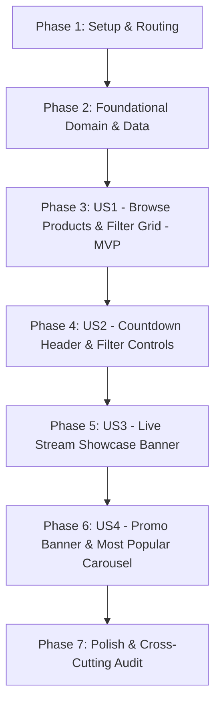

# Tasks: Flash Sale Screen

**Input**: Design documents and specifications from `/specs/003-flash-sale-screen/`
**Prerequisites**: [plan.md](./plan.md), [spec.md](./spec.md), [research.md](./research.md), [data-model.md](./data-model.md), [contracts/](./contracts/)
**Branch**: `feature/flash-sale`
**Organization**: Tasks are grouped into Setup, Foundational, and User Story phases (P1 → P2 → P3 → P4) to enable independent implementation and testing of each story.

## Format: `- [ ] [TaskID] [P?] [Story?] Description with file path`

- **[P]**: Parallelizable (touches independent files, no blocking dependencies)
- **[Story]**: Belongs to specific user story ([US1], [US2], [US3], [US4])
- Every task includes: Prerequisites, Estimated Effort, and Quality Gate

---

## Phase 1: Setup (Shared Infrastructure & Routing)

**Purpose**: Route definitions, dependency injection skeleton, and navigation setup inside the persistent shell.

- [X] T001 Define route name constant in lib/config/routing/route_names.dart
  - **Prerequisites**: None
  - **Estimated Effort**: 5m
  - **Quality Gate**: `static const kFlashSalePage = '/flash-sale';` is added to `RouteNames` and exported cleanly.

- [X] T002 [P] Create dependency injection module file in lib/features/flash_sale/flash_sale_injection.dart
  - **Prerequisites**: None
  - **Estimated Effort**: 10m
  - **Quality Gate**: `initFlashSale()` function stub created and registered inside `lib/core/di/injection_container.dart` without compilation errors.

- [X] T003 [P] Register /flash-sale route inside the Home branch of StatefulShellRoute.indexedStack in lib/config/routing/app_router.dart
  - **Prerequisites**: T001
  - **Estimated Effort**: 15m
  - **Quality Gate**: `/flash-sale` is configured inside the Home `StatefulShellBranch`, guaranteeing Home tab remains active (`index 0`) and bottom navigation remains visible when navigating to Flash Sale.

- [X] T004 Wire navigation trigger to /flash-sale using GoRouter.of(context).push in lib/features/home/presentation/pages/home_page.dart
  - **Prerequisites**: T001, T003
  - **Estimated Effort**: 10m
  - **Quality Gate**: Tapping Flash Sale section header or timer invokes `GoRouter.of(context).push(RouteNames.kFlashSalePage)` without replacing root shell.

---

## Phase 2: Foundational (Domain & Data Core Infrastructure)

**Purpose**: Core domain entities, contracts, mock data sources, repository implementation, and Cubit state management. MUST be completed before User Story UI work.

- [X] T005 [P] Implement FlashSaleProductEntity in lib/features/flash_sale/domain/entities/flash_sale_product_entity.dart
  - **Prerequisites**: None
  - **Estimated Effort**: 10m
  - **Quality Gate**: Extends `Equatable`, contains `id`, `title`, `currentPrice`, `originalPrice`, `imageUrl`, `discountPercentage`, `likeCount`, `tag`.

- [X] T006 [P] Implement LiveStreamEntity in lib/features/flash_sale/domain/entities/live_stream_entity.dart
  - **Prerequisites**: None
  - **Estimated Effort**: 10m
  - **Quality Gate**: Extends `Equatable`, contains `id`, `title`, `bannerUrl`, `isLive`, `viewerCount`.

- [X] T007 [P] Implement FlashSaleDataEntity aggregate in lib/features/flash_sale/domain/entities/flash_sale_data_entity.dart
  - **Prerequisites**: T005, T006
  - **Estimated Effort**: 10m
  - **Quality Gate**: Extends `Equatable`, aggregates `products`, `liveStream`, `popularProducts`, `countdownDuration`.

- [X] T008 [P] Define FlashSaleRepository contract in lib/features/flash_sale/domain/repositories/flash_sale_repository.dart
  - **Prerequisites**: T007
  - **Estimated Effort**: 10m
  - **Quality Gate**: Abstract interface returning `Future<Either<Failure, FlashSaleDataEntity>> getFlashSaleData()`.

- [X] T009 Implement GetFlashSaleProductsUseCase in lib/features/flash_sale/domain/usecases/get_flash_sale_data_usecase.dart
  - **Prerequisites**: T008
  - **Estimated Effort**: 10m
  - **Quality Gate**: Implements `UseCase<FlashSaleDataEntity, NoParams>` and calls `repository.getFlashSaleData()`.

- [X] T010 [P] Implement FlashSaleProductModel in lib/features/flash_sale/data/models/flash_sale_product_model.dart
  - **Prerequisites**: T005
  - **Estimated Effort**: 15m
  - **Quality Gate**: Subclasses `FlashSaleProductEntity`, implements robust `fromJson` and `toJson` supporting double/num prices and discount parsing.

- [X] T011 [P] Implement LiveStreamModel in lib/features/flash_sale/data/models/live_stream_model.dart
  - **Prerequisites**: T006
  - **Estimated Effort**: 10m
  - **Quality Gate**: Subclasses `LiveStreamEntity`, implements `fromJson` and `toJson`.

- [X] T012 Implement FlashSaleDataModel in lib/features/flash_sale/data/models/flash_sale_data_model.dart
  - **Prerequisites**: T007, T010, T011
  - **Estimated Effort**: 15m
  - **Quality Gate**: Subclasses `FlashSaleDataEntity`, implements `fromJson` and `toJson` parsing nested lists and duration.

- [X] T013 [P] Define FlashSaleMockDataSource interface in lib/features/flash_sale/data/datasources/flash_sale_mock_datasource.dart
  - **Prerequisites**: T012
  - **Estimated Effort**: 5m
  - **Quality Gate**: Abstract contract defines `Future<FlashSaleDataModel> getFlashSaleData()`.

- [X] T014 Implement FlashSaleMockDataSourceImpl in lib/features/flash_sale/data/datasources/flash_sale_mock_datasource_impl.dart
  - **Prerequisites**: T013
  - **Estimated Effort**: 25m
  - **Quality Gate**: Simulates 1200ms delay and provides categorized mock products for discount tiers (10%, 20%, 30%, 40%, 50%), live stream entity, and popular products.

- [X] T015 Implement FlashSaleRepositoryImpl with safeCall in lib/features/flash_sale/data/repositories/flash_sale_repository_impl.dart
  - **Prerequisites**: T008, T014
  - **Estimated Effort**: 15m
  - **Quality Gate**: Implements `FlashSaleRepository`, wraps mock data call in `safeCall`, returning `Right(data)` or `Left(Failure)`.

- [X] T016 [P] Implement FlashSaleState with Equatable in lib/features/flash_sale/presentation/cubit/flash_sale_state.dart
  - **Prerequisites**: T007
  - **Estimated Effort**: 15m
  - **Quality Gate**: Defines `FlashSaleInitial`, `FlashSaleLoading`, `FlashSaleLoaded` (with `allProducts`, `filteredProducts`, `selectedDiscount`, `liveStream`, `popularProducts`, `countdownDuration`), and `FlashSaleError`.

- [X] T017 Implement FlashSaleCubit in lib/features/flash_sale/presentation/cubit/flash_sale_cubit.dart
  - **Prerequisites**: T009, T016
  - **Estimated Effort**: 20m
  - **Quality Gate**: Implements `loadFlashSaleData()`, `selectDiscountFilter(int?)` with synchronous in-memory filtering, and `refresh()`.

- [X] T018 [P] Implement FlashSaleShimmerLoading placeholder in lib/features/flash_sale/presentation/widgets/flash_sale_shimmer_loading.dart
  - **Prerequisites**: None
  - **Estimated Effort**: 20m
  - **Quality Gate**: Uses `shimmer` package to mirror screen layout (app bar skeleton, chip skeletons, live banner placeholder, 2-column grid cards) without UI overflow.

- [X] T019 Register dependencies in lib/features/flash_sale/flash_sale_injection.dart
  - **Prerequisites**: T002, T009, T014, T015, T017
  - **Estimated Effort**: 10m
  - **Quality Gate**: Registers `FlashSaleCubit` (Factory), `GetFlashSaleDataUseCase` (LazySingleton), `FlashSaleRepository` (LazySingleton), and `FlashSaleMockDataSource` (LazySingleton) into `sl`.

---

## Phase 3: User Story 1 - Browse Flash Sale Products by Discount Filter (Priority: P1) 🎯 MVP

**Goal**: Shoppers can view flash sale products filtered by discount tiers (All, 10%, 20%, 30%, 40%, 50%) in a 2-column grid with dedicated product cards.

**Independent Test**: Navigate to `/flash-sale`, observe default 20% discount filter active with matching products in a 2-column grid, tap another discount chip (e.g. 30%), and verify instant update of the section title and product items.

- [X] T020 [P] [US1] Create NEW FlashSaleProductCard widget in lib/features/flash_sale/presentation/widgets/flash_sale_product_card.dart
  - **Prerequisites**: T005
  - **Estimated Effort**: 25m
  - **Quality Gate**: DO NOT modify `ProductCardStandard`. Creates specialized card with grey image container (`#E5E6EA`), `BlendMode.darken`, top-right gradient discount badge (e.g. `-20%`), 2-line title, bold black price (`$16,00`) in Raleway font, and strikethrough red/pink original price (`$20,00`). Fully responsive via `flutter_screenutil`.

- [X] T021 [P] [US1] Create DiscountFilterBar widget in lib/features/flash_sale/presentation/widgets/discount_filter_bar.dart
  - **Prerequisites**: None
  - **Estimated Effort**: 20m
  - **Quality Gate**: Renders horizontal scrollable chips: "All", "10%", "20%", "30%", "40%", "50%". Selected chip displays custom active pill indicator styling; unselected chips render clean subtle border/background. Calls `onDiscountSelected(int?)`.

- [X] T022 [US1] Create core FlashSalePage scaffold in lib/features/flash_sale/presentation/pages/flash_sale_page.dart
  - **Prerequisites**: T017, T018, T020, T021
  - **Estimated Effort**: 30m
  - **Quality Gate**: Integrates `BlocProvider`, `BlocBuilder<FlashSaleCubit, FlashSaleState>`, renders `FlashSaleShimmerLoading` when loading, and mounts `DiscountFilterBar`, REUSED `HomeSectionHeader` (`[X]% Discount`), and 2-column `GridView.builder` with `FlashSaleProductCard`s when loaded.

- [X] T023 [US1] Connect interactive discount filter selection with FlashSaleCubit in lib/features/flash_sale/presentation/pages/flash_sale_page.dart
  - **Prerequisites**: T022
  - **Estimated Effort**: 15m
  - **Quality Gate**: Tapping a discount chip immediately invokes `cubit.selectDiscountFilter()`, updating the section header (e.g. "30% Discount") and product grid in <16ms without flickering or network calls.

---

## Phase 4: User Story 2 - Flash Sale Header with Live Countdown & Filter Controls (Priority: P2)

**Goal**: Display an urgent countdown header with soft blue gradient aura, stopwatch icon, 3 countdown boxes (HH:MM:SS), subtitle, and settings filter control.

**Independent Test**: Verify top AppBar displays "Flash Sale", active ticking countdown `[00] [36] [58]`, subtitle "Choose Your Discount", and gear icon on the discount section title.

- [X] T024 [P] [US2] Create FlashSaleAppBar widget in lib/features/flash_sale/presentation/widgets/flash_sale_app_bar.dart
  - **Prerequisites**: None
  - **Estimated Effort**: 25m
  - **Quality Gate**: Custom AppBar area with soft blue aura gradient background, back button calling `context.pop()`, bold "Flash Sale" title (~22sp), embedded REUSED `FlashSaleTimer` (`lib/features/home/presentation/widgets/flash_sale_timer.dart`), and "Choose Your Discount" subtitle.

- [X] T025 [US2] Integrate FlashSaleAppBar and section filter gear control in lib/features/flash_sale/presentation/pages/flash_sale_page.dart
  - **Prerequisites**: T023, T024
  - **Estimated Effort**: 15m
  - **Quality Gate**: Replaces default header in `FlashSalePage` with `FlashSaleAppBar`, and supplies `trailing: Icon(Icons.settings_outlined)` to the discount `HomeSectionHeader` with tap feedback.

---

## Phase 5: User Story 3 - Live Stream Banner & Promotional Media Showcase (Priority: P3)

**Goal**: Present featured live shopping event banner ("ARTICALE REIMAGINED" / "LIVE") with collage imagery and play button.

**Independent Test**: Scroll past the discount filter bar to see the live stream banner with promotional collage, play button, and bright green "LIVE" badge.

- [X] T026 [P] [US3] Create FlashSaleLiveBanner widget in lib/features/flash_sale/presentation/widgets/flash_sale_live_banner.dart
  - **Prerequisites**: T006
  - **Estimated Effort**: 25m
  - **Quality Gate**: Rounded rectangle card with multi-model promotional imagery, translucent circular play button overlay, title "ARTICALE REIMAGINED", and bright green pill badge with uppercase bold "LIVE" text. Supports `onTap` interaction.

- [X] T027 [US3] Mount FlashSaleLiveBanner into FlashSalePage in lib/features/flash_sale/presentation/pages/flash_sale_page.dart
  - **Prerequisites**: T025, T026
  - **Estimated Effort**: 15m
  - **Quality Gate**: Inserted between `DiscountFilterBar` and the discount section header in `FlashSalePage`, populating data from `state.liveStream`.

---

## Phase 6: User Story 4 - Mid-Page Promotional Banner & "Most Popular" Carousel (Priority: P4)

**Goal**: Showcase "Big Sale Up to 50%" promotional split banner and horizontal "Most Popular" trending products carousel with view/like stats.

**Independent Test**: Scroll past the flash sale grid, view the static dual-tone promo banner, and browse the horizontal "Most Popular" carousel with like counts and badges.

- [X] T028 [P] [US4] Create NEW FlashSalePromoBanner widget in lib/features/flash_sale/presentation/widgets/flash_sale_promo_banner.dart
  - **Prerequisites**: None
  - **Estimated Effort**: 25m
  - **Quality Gate**: Different from `HomeHeroBanner` (which is a carousel with dots). Implements static dual-tone rounded banner matching Figma: mustard gold background, curved blue splash, "Big Sale", "Up to 50%", "Happening Now", and model graphic.

- [X] T029 [US4] Integrate FlashSalePromoBanner and Most Popular carousel in lib/features/flash_sale/presentation/pages/flash_sale_page.dart
  - **Prerequisites**: T027, T028
  - **Estimated Effort**: 25m
  - **Quality Gate**: Below the product grid, renders `FlashSalePromoBanner`, followed by REUSED `HomeSectionHeader` (`title: 'Most Popular'`, `showSeeAll: true` with blue circular arrow), and a horizontal `ListView.separated` of REUSED `PopularProductCard`s (`lib/features/home/presentation/widgets/popular_product_card.dart`).

---

## Phase 7: Polish & Cross-Cutting Concerns

**Purpose**: Pull-to-refresh, responsive layout audit, analyzer checks, and zero-defect quality gate.

- [X] T030 [P] Implement pull-to-refresh on FlashSalePage in lib/features/flash_sale/presentation/pages/flash_sale_page.dart
  - **Prerequisites**: T029
  - **Estimated Effort**: 10m
  - **Quality Gate**: Pulling down on `CustomScrollView` / `SingleChildScrollView` triggers `cubit.refresh()` with `RefreshIndicator` styled using `AppColors.primary400`.

- [X] T031 Perform ScreenUtil responsive audit across standard device viewports in lib/features/flash_sale/presentation/pages/flash_sale_page.dart
  - **Prerequisites**: T030
  - **Estimated Effort**: 15m
  - **Quality Gate**: Zero `RenderFlex` overflow errors on 375x812, 390x844, and 412x915 viewports; all dimensions use `.w`, `.h`, `.r`, `.sp`.

- [X] T032 Run static analysis and lint audit with flutter analyze
  - **Prerequisites**: T031
  - **Estimated Effort**: 10m
  - **Quality Gate**: `flutter analyze` runs cleanly with 0 errors, 0 warnings across all modified and newly created files.

---

## Dependencies & Execution Order

### Phase Dependencies



### User Story Execution Rules

- **User Story 1 (P1 - MVP)**: Can begin as soon as Phase 2 completes. Delivers the core browsing experience with discount chips and product cards.
- **User Story 2 (P2)**: Extends US1 by replacing the basic header with `FlashSaleAppBar` and adding settings gear actions.
- **User Story 3 (P3)**: Extends US2 by inserting the live media showcase banner.
- **User Story 4 (P4)**: Extends US3 by adding the promotional banner and popular products carousel at the bottom.
- **Polish (Phase 7)**: Finalizes pull-to-refresh, responsive styling, and executes static analysis.

### Parallel Opportunities

- **Setup Tasks**: T002 [P] and T003 [P] can run in parallel.
- **Foundational Domain & Data**: T005 [P], T006 [P], T007 [P], T008 [P], T010 [P], T011 [P], T013 [P], T016 [P], T018 [P] can run in parallel.
- **Widgets Across Stories**: Once Phase 2 is complete, T020 [P] (`FlashSaleProductCard`), T021 [P] (`DiscountFilterBar`), T024 [P] (`FlashSaleAppBar`), T026 [P] (`FlashSaleLiveBanner`), and T028 [P] (`FlashSalePromoBanner`) can all be built independently in parallel because they reside in distinct files.

---

## Parallel Execution Example: Widget Development

```bash
# Developer A or Parallel Agent: US1 Widgets
- Create FlashSaleProductCard in lib/features/flash_sale/presentation/widgets/flash_sale_product_card.dart
- Create DiscountFilterBar in lib/features/flash_sale/presentation/widgets/discount_filter_bar.dart

# Developer B or Parallel Agent: US2 & US3 Widgets
- Create FlashSaleAppBar in lib/features/flash_sale/presentation/widgets/flash_sale_app_bar.dart
- Create FlashSaleLiveBanner in lib/features/flash_sale/presentation/widgets/flash_sale_live_banner.dart

# Developer C or Parallel Agent: US4 Widgets
- Create FlashSalePromoBanner in lib/features/flash_sale/presentation/widgets/flash_sale_promo_banner.dart
```

---

## Implementation Strategy

### MVP First (Phases 1-3)
1. Complete **Phase 1** (Setup & Routing) and **Phase 2** (Foundational Domain, Data, Cubit).
2. Implement **Phase 3** (User Story 1: Product Grid & Filter Bar).
3. **STOP & VALIDATE**: Test `/flash-sale` route from Home, switch discount filters, verify grid updates.

### Incremental Feature Additions (Phases 4-6)
4. Add **User Story 2**: Header with countdown timer and filter gear icon.
5. Add **User Story 3**: Live Stream showcase card.
6. Add **User Story 4**: Split promotional banner and "Most Popular" trending carousel.

### Final Verification (Phase 7)
7. Add pull-to-refresh, verify responsive scaling, and run `flutter analyze`.
