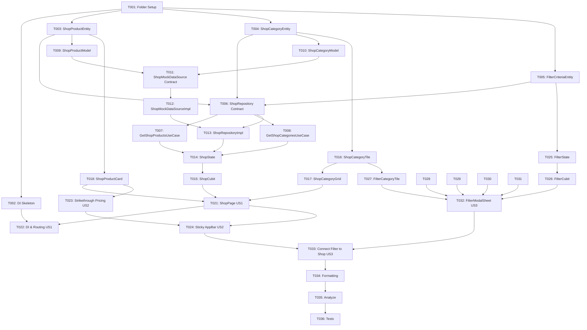

# Tasks: Shop Feature (Screens 25, 26, 33)

**Input**: Design documents and specifications from `/specs/004-shop-screen/`
**Prerequisites**: [plan.md](./plan.md), [spec.md](./spec.md), [research.md](./research.md), [data-model.md](./data-model.md), [contracts/](./contracts/)
**Branch**: `feature/shop`
**Organization**: Tasks are grouped into Setup, Foundational, and User Story phases (P1 → P2 → P3) to enable independent implementation and testing of each story.

## Format: `- [ ] [TaskID] [P?] [Story?] Description with file path`

- **[P]**: Parallelizable (touches independent files, no blocking dependencies)
- **[Story]**: Belongs to specific user story ([US1], [US2], [US3])
- Every task includes: Prerequisites, Estimated Effort, and Quality Gate

---

## Phase 1: Setup (Directory Structure & Routing Preparation)

**Purpose**: Scaffolding the folder structure under `lib/features/shop/` and dependency injection module skeleton.

- [x] T001 Create complete folder structure in lib/features/shop/
  - **Prerequisites**: None
  - **Estimated Effort**: 5m
  - **Quality Gate**: Directories created: `domain/entities/`, `domain/repositories/`, `domain/usecases/`, `data/models/`, `data/datasources/`, `data/repositories/`, `presentation/cubit/`, `presentation/pages/`, `presentation/widgets/`.

- [x] T002 [P] Create dependency injection module file in lib/features/shop/shop_injection.dart
  - **Prerequisites**: T001
  - **Estimated Effort**: 10m
  - **Quality Gate**: `initShop()` function created and registered inside `lib/core/di/injection_container.dart` without compilation errors.

---

## Phase 2: Foundational (Domain & Data Core Infrastructure)

**Purpose**: Domain entities, repository contracts, use cases, models, mock data source, and repository implementation. MUST be completed before User Story UI work.

- [x] T003 [P] Implement ShopProductEntity in lib/features/shop/domain/entities/shop_product_entity.dart
  - **Prerequisites**: T001
  - **Estimated Effort**: 10m
  - **Quality Gate**: Extends `Equatable`, contains `id`, `title`, `imageUrl`, `price`, `originalPrice`, `isDiscounted`, `category`, `subCategory`, `sizes`, `colors`, `isPopular`, `createdAt`, with `copyWith`.

- [x] T004 [P] Implement ShopCategoryEntity in lib/features/shop/domain/entities/shop_category_entity.dart
  - **Prerequisites**: T001
  - **Estimated Effort**: 10m
  - **Quality Gate**: Extends `Equatable`, contains `id`, `name`, `assetPath`, `isSelected`.

- [x] T005 [P] Implement FilterCriteriaEntity in lib/features/shop/domain/entities/filter_criteria_entity.dart
  - **Prerequisites**: T001
  - **Estimated Effort**: 10m
  - **Quality Gate**: Extends `Equatable`, contains `selectedSubCategories`, `sizeType`, `selectedSize`, `selectedColor`, `minPrice`, `maxPrice`, `sortOption` (enum `ShopSortOption: popular, newest, priceHighToLow`).

- [x] T006 [P] Define ShopRepository contract in lib/features/shop/domain/repositories/shop_repository.dart
  - **Prerequisites**: T003, T004, T005
  - **Estimated Effort**: 10m
  - **Quality Gate**: Abstract interface defining `getProducts({FilterCriteriaEntity? criteria})` and `getCategories()`.

- [x] T007 Implement GetShopProductsUseCase in lib/features/shop/domain/usecases/get_shop_products_usecase.dart
  - **Prerequisites**: T006
  - **Estimated Effort**: 10m
  - **Quality Gate**: Implements `UseCase<List<ShopProductEntity>, FilterCriteriaEntity?>` and delegates to `ShopRepository.getProducts()`.

- [x] T008 [P] Implement GetShopCategoriesUseCase in lib/features/shop/domain/usecases/get_shop_categories_usecase.dart
  - **Prerequisites**: T006
  - **Estimated Effort**: 10m
  - **Quality Gate**: Implements `UseCase<List<ShopCategoryEntity>, NoParams>` and delegates to `ShopRepository.getCategories()`.

- [x] T009 [P] Implement ShopProductModel in lib/features/shop/data/models/shop_product_model.dart
  - **Prerequisites**: T003
  - **Estimated Effort**: 15m
  - **Quality Gate**: Subclasses `ShopProductEntity`, implements `fromJson` and `toJson` supporting numeric price parsing.

- [x] T010 [P] Implement ShopCategoryModel in lib/features/shop/data/models/shop_category_model.dart
  - **Prerequisites**: T004
  - **Estimated Effort**: 10m
  - **Quality Gate**: Subclasses `ShopCategoryEntity`, implements `fromJson` and `toJson`.

- [x] T011 [P] Define ShopMockDataSource interface in lib/features/shop/data/datasources/shop_mock_datasource.dart
  - **Prerequisites**: T009, T010
  - **Estimated Effort**: 5m
  - **Quality Gate**: Abstract contract defining `getProducts()` and `getCategories()`.

- [x] T012 Implement ShopMockDataSourceImpl in lib/features/shop/data/datasources/shop_mock_datasource_impl.dart
  - **Prerequisites**: T011
  - **Estimated Effort**: 25m
  - **Quality Gate**: Supplies mock products matching Figma (blue oversized tee, grey tee, camel v-neck, black shirt, cap, bear-ear hoodie) with prices `$16,00`, `$17,00`, and original price `$20,00`, plus 9 apparel sub-categories.

- [x] T013 Implement ShopRepositoryImpl with safeCall and in-memory filtering in lib/features/shop/data/repositories/shop_repository_impl.dart
  - **Prerequisites**: T006, T012
  - **Estimated Effort**: 20m
  - **Quality Gate**: Implements `ShopRepository`, uses `safeCall`, applies filtering (category, size, color, price range, sort).

---

## Phase 3: User Story 1 (P1) - Main Shop Browsing & Sub-Category Grid (Screen 25)

**Goal**: Shoppers browse products in the Shop screen under the "Clothing" department, view the 2-row category grid (9 items), and view regular products in a responsive 2-column grid.

**Independent Test**: Open Catalog/Shop tab (`/catalog`). Observe "Shop" header, `[Clothing ✕]` pill, camera button, 2-row category grid, "All Items" header with gear icon, and 2-column product grid with `$16,00` prices.

- [x] T014 [US1] Implement ShopState in lib/features/shop/presentation/cubit/shop_state.dart
  - **Prerequisites**: T003, T004, T005
  - **Estimated Effort**: 10m
  - **Quality Gate**: Equatable states: `ShopInitial`, `ShopLoading`, `ShopLoaded`, `ShopError`.

- [x] T015 [US1] Implement ShopCubit in lib/features/shop/presentation/cubit/shop_cubit.dart
  - **Prerequisites**: T007, T008, T014
  - **Estimated Effort**: 20m
  - **Quality Gate**: Methods: `loadShopData()`, `selectSubCategory(String?)`, `applyFilter(FilterCriteriaEntity)`, `clearFilter()`.

- [x] T016 [P] [US1] Create ShopCategoryTile in lib/features/shop/presentation/widgets/shop_category_tile.dart
  - **Prerequisites**: T004
  - **Estimated Effort**: 15m
  - **Quality Gate**: Rounded grey square container (`16.r`, `#F5F5F5`), image illustration, centered category label, tap callback.

- [x] T017 [P] [US1] Create ShopCategoryGrid in lib/features/shop/presentation/widgets/shop_category_grid.dart
  - **Prerequisites**: T016
  - **Estimated Effort**: 15m
  - **Quality Gate**: Renders 2-row category grid (Row 1: Dresses, Pants, Skirts, Tunics, Jackets; Row 2: Hoodies, Shirts, Polo, T-shirts) with responsive ScreenUtil spacing.

- [x] T018 [P] [US1] Create ShopProductCard in lib/features/shop/presentation/widgets/shop_product_card.dart
  - **Prerequisites**: T003
  - **Estimated Effort**: 20m
  - **Quality Gate**: Rounded image container (`16.r`), 2-line title in `textSecondary`, price in bold Raleway (`$16,00`).

- [x] T019 [P] [US1] Create ShopAppBar in lib/features/shop/presentation/widgets/shop_app_bar.dart
  - **Prerequisites**: None
  - **Estimated Effort**: 15m
  - **Quality Gate**: Displays "Shop" title, active `[Clothing ✕]` pill in primary blue styling with dismiss action, camera button, and gear filter button.

- [x] T020 [P] [US1] Create ShopShimmerLoading in lib/features/shop/presentation/widgets/shop_shimmer_loading.dart
  - **Prerequisites**: None
  - **Estimated Effort**: 15m
  - **Quality Gate**: Clean shimmer placeholders for category tiles and product cards during initial load.

- [x] T021 [US1] Assemble ShopPage in lib/features/shop/presentation/pages/shop_page.dart
  - **Prerequisites**: T015, T017, T018, T019, T020
  - **Estimated Effort**: 25m
  - **Quality Gate**: Integrates `BlocProvider`/`BlocBuilder`, displays `ShopAppBar`, `ShopCategoryGrid`, "All Items" row with gear icon, and 2-column `GridView.builder` with `flutter_screenutil`.

- [x] T022 [US1] Wire DI and Routing for ShopPage
  - **Prerequisites**: T002, T015, T021
  - **Estimated Effort**: 15m
  - **Quality Gate**: Complete DI registration in `shop_injection.dart`, invoke `initShop()` in `injection_container.dart`, and replace placeholder `CatalogPage` with `ShopPage` in `app_router.dart` for `/catalog`.

---

## Phase 4: User Story 2 (P2) - Continuous Browsing & Strikethrough Pricing on Scroll (Screen 26)

**Goal**: Shoppers scroll smoothly through the catalog; the top app bar remains pinned with gear icon, and discounted products display bold current price alongside coral red strikethrough original price.

**Independent Test**: Scroll down the Shop page. Verify sticky header remains visible, and discounted cards render `$16,00` or `$17,00` current price with `$20,00` crossed out in coral pink/red (`#FF5790`).

- [x] T023 [US2] Enhance ShopProductCard for discounted pricing in lib/features/shop/presentation/widgets/shop_product_card.dart
  - **Prerequisites**: T018
  - **Estimated Effort**: 15m
  - **Quality Gate**: When `isDiscounted` is true, displays sale price in bold black next to `originalPrice` in strikethrough coral red (`#FF5790` / `AppColors.error`).

- [x] T024 [US2] Implement sticky App Bar behavior on scroll in lib/features/shop/presentation/pages/shop_page.dart
  - **Prerequisites**: T021, T023
  - **Estimated Effort**: 20m
  - **Quality Gate**: `CustomScrollView` with `SliverAppBar` / `SliverPersistentHeader` ensures top bar with "Shop", `[Clothing ✕]`, camera icon, and gear filter button remains pinned when scrolling past the category grid.

---

## Phase 5: User Story 3 (P3) - Multi-Faceted Product Filter Modal (Screen 33)

**Goal**: Shoppers tap the gear icon (`⚙`) to open Screen 33 (Filter), refine products by sub-categories (multi-select), size switcher & pills with custom indicator, color swatches, dynamic price slider, and sort chips.

**Independent Test**: Tap gear icon (`⚙`) to open Filter modal. Select categories (Dresses, Pants), switch Clothes/Shoes, select size `M`, select white color swatch, adjust slider to `$10 - $150`, select `Popular`. Tap `Apply` to see updated Shop catalog. Tap `Clear` to reset. Tap `✕` to dismiss without applying.

- [x] T025 [P] [US3] Implement FilterState in lib/features/shop/presentation/cubit/filter_state.dart
  - **Prerequisites**: T005
  - **Estimated Effort**: 10m
  - **Quality Gate**: Equatable state with `selectedSubCategories`, `sizeType`, `selectedSize`, `selectedColor`, `minPrice`, `maxPrice`, `sortOption`, `copyWith`, and `fromCriteria`.

- [x] T026 [US3] Implement FilterCubit in lib/features/shop/presentation/cubit/filter_cubit.dart
  - **Prerequisites**: T025
  - **Estimated Effort**: 20m
  - **Quality Gate**: Methods: `toggleCategory(name)`, `setSizeType(type)`, `selectSize(size)`, `selectColor(color)`, `updatePriceRange(min, max)`, `setSortOption(option)`, `clearAll()`.

- [x] T027 [P] [US3] Create FilterCategoryTile in lib/features/shop/presentation/widgets/filter_category_tile.dart
  - **Prerequisites**: T016
  - **Estimated Effort**: 15m
  - **Quality Gate**: Category tile with top-right blue circular badge containing white checkmark when selected.

- [x] T028 [P] [US3] Create FilterSizeSection in lib/features/shop/presentation/widgets/filter_size_section.dart
  - **Prerequisites**: None
  - **Estimated Effort**: 20m
  - **Quality Gate**: `[ Clothes | Shoes ]` segmented toggle pill + horizontal size pills (`XS` to `2XL`). Selected size has circular white badge with blue border and indicator notches.

- [x] T029 [P] [US3] Create FilterColorSection in lib/features/shop/presentation/widgets/filter_color_section.dart
  - **Prerequisites**: None
  - **Estimated Effort**: 15m
  - **Quality Gate**: Row of circular swatches (White, Charcoal, Blue, Red, Teal, Yellow, Purple). Active swatch displays blue ring and circular checkmark badge.

- [x] T030 [P] [US3] Create FilterPriceRangeSection in lib/features/shop/presentation/widgets/filter_price_range_section.dart
  - **Prerequisites**: None
  - **Estimated Effort**: 15m
  - **Quality Gate**: Header showing dynamic `$min - $max` label and custom dual-thumb `RangeSlider` with primary blue active track.

- [x] T031 [P] [US3] Create FilterSortSection in lib/features/shop/presentation/widgets/filter_sort_section.dart
  - **Prerequisites**: None
  - **Estimated Effort**: 15m
  - **Quality Gate**: Chips for `Popular` (with circular checkmark), `Newest`, `Price Hight to Low`. Exclusive single-selection.

- [x] T032 [US3] Assemble FilterModalSheet in lib/features/shop/presentation/pages/filter_modal_sheet.dart
  - **Prerequisites**: T026, T027, T028, T029, T030, T031
  - **Estimated Effort**: 25m
  - **Quality Gate**: Header with "Filter" and circular `✕` button; category grid; size section; color swatches; price slider; sort chips; bottom row with `Clear` button and `Apply` button.

- [x] T033 [US3] Connect FilterModalSheet trigger to ShopPage
  - **Prerequisites**: T021, T032
  - **Estimated Effort**: 15m
  - **Quality Gate**: Tapping gear icon (`⚙`) launches `FilterModalSheet` via `showModalBottomSheet`. Tapping `Apply` calls `ShopCubit.applyFilter()` and updates product grid.

---

## Phase 6: Polish, Verification & Quality Gate

**Purpose**: Static analysis, styling consistency, and final validation.

- [x] T034 Run code formatting across the repository
  - **Prerequisites**: T001-T033
  - **Estimated Effort**: 5m
  - **Quality Gate**: `flutter format .` completes with standard formatting.

- [x] T035 Run Flutter static analysis
  - **Prerequisites**: T034
  - **Estimated Effort**: 10m
  - **Quality Gate**: `flutter analyze` passes with 0 errors and 0 warnings.

- [x] T036 Write Presentation Widget Tests in test/features/shop/presentation/shop_page_test.dart
  - **Prerequisites**: T021, T032
  - **Estimated Effort**: 25m
  - **Quality Gate**: Automated widget tests verify `ShopPage` renders category grid, product cards, and opens `FilterModalSheet`.

---

## Dependencies & Parallel Execution

