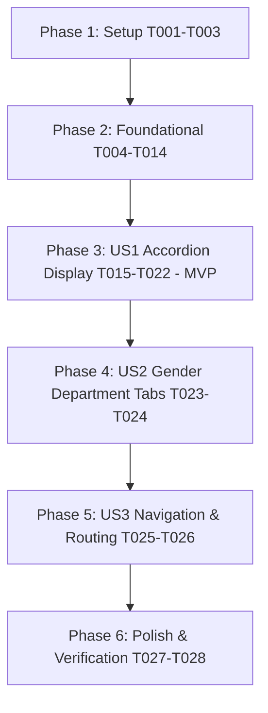

# Tasks: Categories Feature (Screen 27)

**Input**: Design documents and specifications from `/specs/005-categories/`  
**Prerequisites**: [plan.md](./plan.md), [spec.md](./spec.md), [research.md](./research.md), [data-model.md](./data-model.md), [contracts/categories_contracts.md](./contracts/categories_contracts.md)  
**Branch**: `feature/categories`  
**Organization**: Tasks are grouped into Setup, Foundational, User Stories (US1 → US2 → US3), and Polish phases to enable independent implementation and testing.

## Format: `- [ ] [TaskID] [P?] [Story?] Description with file path`

- **[P]**: Parallelizable (independent files, no blocking dependencies on incomplete tasks)
- **[Story]**: Belongs to a specific user story ([US1], [US2], [US3])
- Every task includes Prerequisites, Estimated Effort, and Quality Gate.

---

## Phase 1: Setup (Directory Structure & DI Skeleton)

**Purpose**: Scaffolding directories and injection skeleton for `lib/features/categories/`.

- [x] T001 Create complete folder structure in lib/features/categories/
  - **Prerequisites**: None
  - **Estimated Effort**: 5m
  - **Quality Gate**: Directories created: `domain/entities/`, `domain/repositories/`, `domain/usecases/`, `data/models/`, `data/datasources/`, `data/repositories/`, `presentation/cubit/`, `presentation/pages/`, `presentation/widgets/`.

- [x] T002 [P] Create initial dependency injection file in lib/features/categories/categories_injection.dart
  - **Prerequisites**: T001
  - **Estimated Effort**: 5m
  - **Quality Gate**: Defines `initCategories()` function skeleton registered via `sl`.

- [x] T003 [P] Add kCategoriesPage route constant in lib/config/routing/route_names.dart
  - **Prerequisites**: None
  - **Estimated Effort**: 5m
  - **Quality Gate**: `static const kCategoriesPage = '/categories';` added to `RouteNames`.

---

## Phase 2: Foundational (Domain & Data Core Infrastructure)

**Purpose**: Core entities, repository contract, use cases, models, mock datasource, and repository implementation. MUST be completed before UI work.

- [x] T004 [P] Implement GenderFilter enum in lib/features/categories/domain/entities/gender_filter.dart
  - **Prerequisites**: T001
  - **Estimated Effort**: 5m
  - **Quality Gate**: Enum with values `all`, `female`, `male` and display label helpers.

- [x] T005 [P] Implement SubCategoryEntity in lib/features/categories/domain/entities/sub_category_entity.dart
  - **Prerequisites**: T001
  - **Estimated Effort**: 5m
  - **Quality Gate**: Extends `Equatable`, contains `id`, `name`, `parentGroupId`.

- [x] T006 [P] Implement CategoryGroupEntity in lib/features/categories/domain/entities/category_group_entity.dart
  - **Prerequisites**: T004, T005
  - **Estimated Effort**: 10m
  - **Quality Gate**: Extends `Equatable`, contains `id`, `name`, `icon`, `gender`, `subCategories`, `isExpanded`, with `copyWith`.

- [x] T007 Define CategoriesRepository contract in lib/features/categories/domain/repositories/categories_repository.dart
  - **Prerequisites**: T004, T006
  - **Estimated Effort**: 5m
  - **Quality Gate**: Abstract class defining `Future<Either<Failure, List<CategoryGroupEntity>>> getCategories({GenderFilter gender})`.

- [x] T008 Implement GetCategoriesUseCase in lib/features/categories/domain/usecases/get_categories_usecase.dart
  - **Prerequisites**: T007
  - **Estimated Effort**: 5m
  - **Quality Gate**: Implements `UseCase<List<CategoryGroupEntity>, GenderFilter>` delegating to `CategoriesRepository`.

- [x] T009 [P] Implement SubCategoryModel in lib/features/categories/data/models/sub_category_model.dart
  - **Prerequisites**: T005
  - **Estimated Effort**: 10m
  - **Quality Gate**: Extends `SubCategoryEntity`, implements `fromJson`, `toJson`, and `fromEntity`.

- [x] T010 [P] Implement CategoryGroupModel in lib/features/categories/data/models/category_group_model.dart
  - **Prerequisites**: T006, T009
  - **Estimated Effort**: 10m
  - **Quality Gate**: Extends `CategoryGroupEntity`, implements `fromJson`, `toJson`, and `fromEntity`.

- [x] T011 Define CategoriesMockDataSource interface in lib/features/categories/data/datasources/categories_mock_datasource.dart
  - **Prerequisites**: T010
  - **Estimated Effort**: 5m
  - **Quality Gate**: Abstract class defining `Future<List<CategoryGroupModel>> getCategories({GenderFilter gender})`.

- [x] T012 Implement CategoriesMockDataSourceImpl in lib/features/categories/data/datasources/categories_mock_datasource_impl.dart
  - **Prerequisites**: T011
  - **Estimated Effort**: 15m
  - **Quality Gate**: Rich mock dataset matching Screen 27: Clothing (10 subcategories: Dresses, Skirts, Jackets, Shirts, T-Shirts / Pants, Shorts, Hoodies, Polo, Tunics), Shoes, Bags, Accesories. Supports gender filtering.

- [x] T013 Implement CategoriesRepositoryImpl in lib/features/categories/data/repositories/categories_repository_impl.dart
  - **Prerequisites**: T007, T012
  - **Estimated Effort**: 10m
  - **Quality Gate**: Implements `CategoriesRepository` using `safeCall` error wrapper around mock data source.

- [x] T014 Register Categories dependencies in lib/features/categories/categories_injection.dart and lib/core/di/injection_container.dart
  - **Prerequisites**: T002, T008, T013
  - **Estimated Effort**: 10m
  - **Quality Gate**: All layers (DataSource, Repository, UseCase) registered in GetIt; `initCategories()` invoked in `injection_container.dart`.

---

## Phase 3: User Story 1 — Category Accordion Display (Priority: P1) 🎯 MVP

**Goal**: Render Screen 27 with top header, Clothing category expanded by default (10 sub-category pills in 2 columns), and collapsed category rows (Shoes, Bags, Accesories) with single-expansion accordion behavior.

**Independent Test**: Navigate to Categories screen; verify header "All Categories", Clothing expanded with 10 pills, collapsed rows for other categories. Tapping Shoes collapses Clothing and expands Shoes.

- [x] T015 [P] [US1] Implement CategoriesState in lib/features/categories/presentation/cubit/categories_state.dart
  - **Prerequisites**: T006
  - **Estimated Effort**: 10m
  - **Quality Gate**: Equatable states: `CategoriesInitial`, `CategoriesLoading`, `CategoriesLoaded` (with `groups`, `activeGender`, `expandedGroupId`), and `CategoriesError`.

- [x] T016 [US1] Implement CategoriesCubit in lib/features/categories/presentation/cubit/categories_cubit.dart
  - **Prerequisites**: T008, T015
  - **Estimated Effort**: 15m
  - **Quality Gate**: Extends `Cubit<CategoriesState>`, implements `loadCategories()`, `toggleCategoryExpansion(groupId)` enforcing single-expansion logic.

- [x] T017 [P] [US1] Implement CategoriesAppBar in lib/features/categories/presentation/widgets/categories_app_bar.dart
  - **Prerequisites**: T001
  - **Estimated Effort**: 10m
  - **Quality Gate**: Large bold "All Categories" title, right-aligned circular close button (`✕`) with `#F5F5F5` circular background.

- [x] T018 [P] [US1] Implement SubCategoryPill in lib/features/categories/presentation/widgets/sub_category_pill.dart
  - **Prerequisites**: T005
  - **Estimated Effort**: 10m
  - **Quality Gate**: Rounded pill button (`12.r`), light grey fill (`#F5F5F5`), centered typography matching Screen 27, minimum 44dp height.

- [x] T019 [US1] Implement CategoryAccordionTile in lib/features/categories/presentation/widgets/category_accordion_tile.dart
  - **Prerequisites**: T006, T018
  - **Estimated Effort**: 20m
  - **Quality Gate**: Rounded card (`20.r`), left category icon in Primary 400 (`#004BFE`), bold category name, right chevron (`⌄`/`⌃`). Smooth expansion animation with 2-column grid of `SubCategoryPill`s.

- [x] T020 [P] [US1] Implement JustForYouCard in lib/features/categories/presentation/widgets/just_for_you_card.dart
  - **Prerequisites**: T001
  - **Estimated Effort**: 10m
  - **Quality Gate**: Rounded card (`20.r`), blue outline star icon, "Just for you" title, circular Primary 400 button (`#004BFE`) with white arrow (`→`).

- [x] T021 [P] [US1] Implement CategoriesShimmerLoading in lib/features/categories/presentation/widgets/categories_shimmer_loading.dart
  - **Prerequisites**: T001
  - **Estimated Effort**: 10m
  - **Quality Gate**: Shimmer placeholder skeleton matching accordion card dimensions and radii (`20.r`).

- [x] T022 [US1] Assemble CategoriesPage in lib/features/categories/presentation/pages/categories_page.dart
  - **Prerequisites**: T016, T017, T019, T020, T021
  - **Estimated Effort**: 20m
  - **Quality Gate**: `BlocProvider` with `CategoriesCubit`, renders `CategoriesAppBar`, accordion list of `CategoryAccordionTile`s, and `JustForYouCard`. Handles loading and error states.

---

## Phase 4: User Story 2 — Gender Department Tabs (Priority: P2)

**Goal**: Add department tabs (`All`, `Female`, `Male`) with active blue border/text styling and reactive category group filtering.

**Independent Test**: Tap `Female`; verify blue outline and blue text on Female tab, grey fill on others. Category list refreshes for Female department. Tap `Male` and verify identical behavior.

- [x] T023 [P] [US2] Implement GenderTabBar in lib/features/categories/presentation/widgets/gender_tab_bar.dart
  - **Prerequisites**: T004
  - **Estimated Effort**: 15m
  - **Quality Gate**: Horizontal row of 3 tabs (`All`, `Female`, `Male`). Active tab styled with Primary 400 (`#004BFE`) border, white background, blue text. Inactive tabs styled with `#F5F5F5` fill.

- [x] T024 [US2] Wire GenderTabBar in CategoriesCubit and CategoriesPage in lib/features/categories/presentation/cubit/categories_cubit.dart and lib/features/categories/presentation/pages/categories_page.dart
  - **Prerequisites**: T022, T023
  - **Estimated Effort**: 10m
  - **Quality Gate**: `selectGender(gender)` in Cubit triggers category list reload/filter; `GenderTabBar` placed below `CategoriesAppBar` in `CategoriesPage`.

---

## Phase 5: User Story 3 — Navigation & Dismiss Actions (Priority: P3)

**Goal**: Wire sub-category taps to `/catalog?subCategory=<name>`, "Just for you" tap to `/catalog?filter=just_for_you`, circular `✕` to `context.pop()`, and register `/categories` route in router.

**Independent Test**: Tap "Dresses" pill → navigates to `/catalog?subCategory=Dresses`. Tap "Just for you" → navigates to `/catalog?filter=just_for_you`. Tap `✕` → dismisses screen.

- [x] T025 [US3] Register /categories route in lib/config/routing/app_router.dart
  - **Prerequisites**: T003, T022
  - **Estimated Effort**: 10m
  - **Quality Gate**: `GoRoute` with path `RouteNames.kCategoriesPage` returning `CategoriesPage`.

- [x] T026 [US3] Wire tap handlers for sub-categories, Just for you, and dismiss button in lib/features/categories/presentation/pages/categories_page.dart
  - **Prerequisites**: T024, T025
  - **Estimated Effort**: 15m
  - **Quality Gate**: Sub-category pill tap invokes `context.pushNamed('catalog', queryParameters: {'subCategory': name})` or equivalent; "Just for you" navigates with `filter=just_for_you`; `✕` button calls `context.pop()`.

---

## Phase 6: Polish (Final Verification & Tests)

**Purpose**: Automated widget tests and final static code analysis. Run strictly ONCE at the end per Permanent Rule 1.

- [x] T027 [P] Implement widget tests for Categories in test/features/categories/presentation/categories_page_test.dart
  - **Prerequisites**: T026
  - **Estimated Effort**: 20m
  - **Quality Gate**: Tests verifying `CategoriesPage` renders header, gender tabs, default expanded `Clothing`, accordion toggle on tap, and close button tap.

- [x] T028 Code formatting and final static analysis verification
  - **Prerequisites**: T027
  - **Estimated Effort**: 10m
  - **Quality Gate**: `dart format` applied, and `flutter analyze` passes with 0 errors and 0 warnings.

---

## Dependencies & Completion Order

---

## Parallel Execution Opportunities

- **Phase 1**: `T002` (DI file) and `T003` (route name) can run in parallel after `T001`.
- **Phase 2**: `T004` (enum), `T005` (entity), `T006` (entity) can run in parallel; `T009` and `T010` (models) can run in parallel.
- **Phase 3**: `T015` (state), `T017` (app bar), `T018` (pill), `T020` (just for you), `T021` (shimmer) can run in parallel before page assembly (`T022`).
- **Phase 4**: `T023` (tab bar widget) can be developed in parallel with Cubit integration.

---

## Implementation Strategy

### MVP First (Phases 1, 2, 3)
1. Complete Setup (`T001`–`T003`)
2. Complete Foundational (`T004`–`T014`)
3. Complete User Story 1 (`T015`–`T022`)
4. **VALIDATE MVP**: Screen 27 renders with default expanded Clothing and collapsible categories.

### Incremental Delivery
5. Complete User Story 2 (`T023`–`T024`): Add gender department switching.
6. Complete User Story 3 (`T025`–`T026`): Connect navigation and modal dismiss.
7. Complete Polish (`T027`–`T028`): Run widget tests and static analysis.

---

## Permanent Project Rules Reference

All tasks MUST strictly adhere to the Permanent Project Rules from `.specify/instructions/permanent-project-rules.md`:
1. **Verification Timing**: Do NOT run `flutter analyze` or `flutter test` after each individual task. Save all static analysis and verification strictly for the final phase to save tokens and time.
2. **Asset Policy**: Do NOT generate any new placeholder images, icons, or asset files. Reuse existing assets located in `assets/images/` and `assets/design_references/` only. Use provided Figma screenshots strictly as visual references.
3. **Architectural Adherence**: STRICTLY adhere to the project Constitution, Feature-First Clean Architecture, Design Tokens (`app_colors`, `app_spacing`, `app_typography`, `app_theme`), and all established coding standards.
4. **Code Quality & Design Patterns**: Write clean, production-ready Dart code using proper Design Patterns (Repository, UseCase, Cubit/Bloc, Factory for models, etc.). Extract all reusable UI components into separate widget files.
5. **Dimensions & Frameworks**: All dimensions must use `flutter_screenutil` (`.w`, `.h`, `.r`, `.sp`). All navigation must use `go_router`. All state management must use `flutter_bloc` (Cubit) with `equatable` states.
6. **Component Reuse**: Reuse existing shared widgets and components from previous features (e.g., DiscountBadge, ShopProductCard, PrimaryButton, etc.) whenever applicable.
7. **Clean Architecture Layers**: Every feature must include: Domain (entities, repository contract, usecases), Data (models, mock datasource, repository impl with `safeCall`), Presentation (cubit, state, pages, widgets), DI registration, and routing.
8. **Phase 1 Data Scope**: Mock Data only in Phase 1 (no real API).
9. **Loading Experience**: Shimmer placeholders for all loading states.
10. **Visual Perfection**: Pixel-perfect match with the Figma screenshots (colors, spacing, radius, typography).
