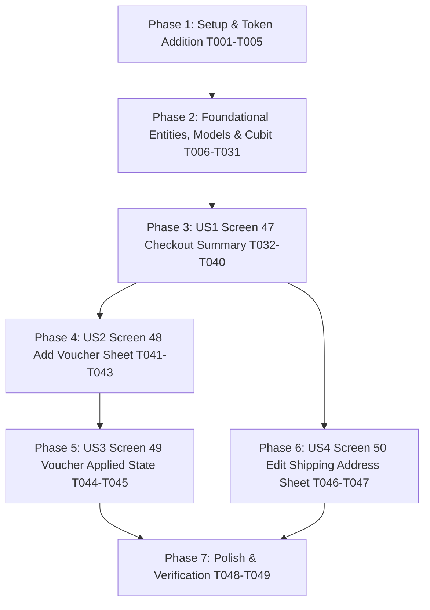

# Tasks: Checkout Feature (Screens 47, 48, 49, 50)

**Input**: Design documents and specifications from `/specs/009-checkout/`  
**Prerequisites**: [plan.md](./plan.md), [spec.md](./spec.md), [research.md](./research.md), [data-model.md](./data-model.md), [contracts/checkout_contracts.md](./contracts/checkout_contracts.md)  
**Branch**: `009-checkout`  
**Organization**: Tasks are grouped into Setup, Foundational, User Stories (US1 → US2 → US3 → US4), and Polish phases to enable independent implementation and testing.

## Format: `- [ ] [TaskID] [P?] [Story?] Description with file path`

- **[P]**: Parallelizable (independent files, no blocking dependencies on incomplete tasks)
- **[Story]**: Belongs to a specific user story ([US1], [US2], [US3], [US4])
- Every task includes Prerequisites, Estimated Effort, and Quality Gate.

---

## Phase 1: Setup (Directory Structure, DI Skeleton & Route Placeholders)

**Purpose**: Scaffolding directories, adding design tokens, route placeholders, and DI skeleton for `lib/features/checkout/`.

- [x] T001 Add primarySoft token to lib/core/theme/app_colors.dart
  - **Prerequisites**: None
  - **Estimated Effort**: 3m
  - **Quality Gate**: Rule #11 enforcement: `static const Color primarySoft = Color(0xFFEBF1FF);` added to `AppColors` for soft blue input backgrounds (Screen 50), selected shipping options (Screen 47), and variant pills.

- [x] T002 Create complete folder structure in lib/features/checkout/
  - **Prerequisites**: None
  - **Estimated Effort**: 3m
  - **Quality Gate**: Directories created: `domain/entities/`, `domain/repositories/`, `domain/usecases/`, `data/models/`, `data/datasources/`, `data/repositories/`, `presentation/manager/`, `presentation/pages/`, `presentation/widgets/`.

- [x] T003 [P] Add checkout route constant in lib/config/routes/app_router.dart
  - **Prerequisites**: None
  - **Estimated Effort**: 3m
  - **Quality Gate**: Route path `static const String checkout = '/checkout';` defined for checkout entry.

- [x] T004 [P] Configure checkout and payment route placeholders in lib/config/routes/app_router.dart
  - **Prerequisites**: T003
  - **Estimated Effort**: 5m
  - **Quality Gate**: `/checkout` route configured with placeholder and `/payment` route configured with placeholder to ensure smooth navigation handoff without crashing.

- [x] T005 Wire initCheckoutInjection in lib/core/di/injection_container.dart
  - **Prerequisites**: T002
  - **Estimated Effort**: 3m
  - **Quality Gate**: `initCheckoutInjection()` invoked inside `init()` in `injection_container.dart`.

---

## Phase 2: Foundational (Domain Entities, Repository Contract, Use Cases & Data Layer)

**Purpose**: Core domain entities, repository contract, use cases, data models, mock data source, and repository implementation with `safeCall`. MUST be completed before UI work.

- [x] T006 [P] Implement OrderItemEntity in lib/features/checkout/domain/entities/order_item_entity.dart
  - **Prerequisites**: T002
  - **Estimated Effort**: 5m
  - **Quality Gate**: Extends `Equatable`, contains `id`, `productId`, `title`, `imageUrl`, `quantity`, `size`, `color`, `unitPrice`, and computed `totalPrice`.

- [x] T007 [P] Implement ShippingAddressEntity in lib/features/checkout/domain/entities/shipping_address_entity.dart
  - **Prerequisites**: T002
  - **Estimated Effort**: 5m
  - **Quality Gate**: Extends `Equatable`, contains `id`, `country`, `city`, `street`, `zipCode`, and `formattedAddress`.

- [x] T008 [P] Implement ContactInfoEntity in lib/features/checkout/domain/entities/contact_info_entity.dart
  - **Prerequisites**: T002
  - **Estimated Effort**: 5m
  - **Quality Gate**: Extends `Equatable`, contains `id`, `phone`, and `email`.

- [x] T009 [P] Implement ShippingOptionEntity in lib/features/checkout/domain/entities/shipping_option_entity.dart
  - **Prerequisites**: T002
  - **Estimated Effort**: 5m
  - **Quality Gate**: Extends `Equatable`, contains `id`, `name`, `duration`, `price`, `estimatedDate`, and `isSelected`.

- [x] T010 [P] Implement VoucherEntity in lib/features/checkout/domain/entities/voucher_entity.dart
  - **Prerequisites**: T002
  - **Estimated Effort**: 5m
  - **Quality Gate**: Extends `Equatable`, contains `id`, `title`, `description`, `discountPercentage`, `validUntil`, `code`, and `iconType`.

- [x] T011 Implement CheckoutSummaryEntity in lib/features/checkout/domain/entities/checkout_summary_entity.dart
  - **Prerequisites**: T006, T007, T008, T009, T010
  - **Estimated Effort**: 5m
  - **Quality Gate**: Extends `Equatable`, aggregates `shippingAddress`, `contactInfo`, `items`, `shippingOptions`, `selectedShippingOption`, `appliedVoucher`, `selectedPaymentMethod`, and computed `subtotal`, `discountAmount`, `shippingFee`, and `total`.

- [x] T012 Define CheckoutRepository contract in lib/features/checkout/domain/repositories/checkout_repository.dart
  - **Prerequisites**: T011
  - **Estimated Effort**: 5m
  - **Quality Gate**: Abstract class defining `getCheckoutSummary()`, `getActiveVouchers()`, `applyVoucher()`, `removeVoucher()`, `updateShippingOption()`, `updateShippingAddress()`, and `updatePaymentMethod()`, each returning `Either<Failure, CheckoutSummaryEntity>` using `dartz` and core `Failure`.

- [x] T013 [P] Implement GetCheckoutSummaryUseCase in lib/features/checkout/domain/usecases/get_checkout_summary_usecase.dart
  - **Prerequisites**: T012
  - **Estimated Effort**: 5m
  - **Quality Gate**: Implements `UseCase<CheckoutSummaryEntity, NoParams>` delegating to `CheckoutRepository.getCheckoutSummary()`.

- [x] T014 [P] Implement GetActiveVouchersUseCase in lib/features/checkout/domain/usecases/get_active_vouchers_usecase.dart
  - **Prerequisites**: T012
  - **Estimated Effort**: 5m
  - **Quality Gate**: Implements `UseCase<List<VoucherEntity>, NoParams>` delegating to `CheckoutRepository.getActiveVouchers()`.

- [x] T015 [P] Implement ApplyVoucherUseCase in lib/features/checkout/domain/usecases/apply_voucher_usecase.dart
  - **Prerequisites**: T012
  - **Estimated Effort**: 5m
  - **Quality Gate**: Implements `UseCase<CheckoutSummaryEntity, String>` delegating to `CheckoutRepository.applyVoucher()`.

- [x] T016 [P] Implement RemoveVoucherUseCase in lib/features/checkout/domain/usecases/remove_voucher_usecase.dart
  - **Prerequisites**: T012
  - **Estimated Effort**: 5m
  - **Quality Gate**: Implements `UseCase<CheckoutSummaryEntity, NoParams>` delegating to `CheckoutRepository.removeVoucher()`.

- [x] T017 [P] Implement UpdateShippingOptionUseCase in lib/features/checkout/domain/usecases/update_shipping_option_usecase.dart
  - **Prerequisites**: T012
  - **Estimated Effort**: 5m
  - **Quality Gate**: Implements `UseCase<CheckoutSummaryEntity, String>` delegating to `CheckoutRepository.updateShippingOption()`.

- [x] T018 [P] Implement UpdateShippingAddressUseCase in lib/features/checkout/domain/usecases/update_shipping_address_usecase.dart
  - **Prerequisites**: T012
  - **Estimated Effort**: 5m
  - **Quality Gate**: Implements `UseCase<CheckoutSummaryEntity, ShippingAddressEntity>` delegating to `CheckoutRepository.updateShippingAddress()`.

- [x] T019 [P] Implement OrderItemModel in lib/features/checkout/data/models/order_item_model.dart
  - **Prerequisites**: T006
  - **Estimated Effort**: 5m
  - **Quality Gate**: Extends `OrderItemEntity`, implements `fromJson`, `toJson`, `fromEntity`, `toEntity`.

- [x] T020 [P] Implement ShippingAddressModel in lib/features/checkout/data/models/shipping_address_model.dart
  - **Prerequisites**: T007
  - **Estimated Effort**: 5m
  - **Quality Gate**: Extends `ShippingAddressEntity`, implements `fromJson`, `toJson`, `fromEntity`, `toEntity`.

- [x] T021 [P] Implement ContactInfoModel in lib/features/checkout/data/models/contact_info_model.dart
  - **Prerequisites**: T008
  - **Estimated Effort**: 5m
  - **Quality Gate**: Extends `ContactInfoEntity`, implements `fromJson`, `toJson`, `fromEntity`, `toEntity`.

- [x] T022 [P] Implement ShippingOptionModel in lib/features/checkout/data/models/shipping_option_model.dart
  - **Prerequisites**: T009
  - **Estimated Effort**: 5m
  - **Quality Gate**: Extends `ShippingOptionEntity`, implements `fromJson`, `toJson`, `fromEntity`, `toEntity`.

- [x] T023 [P] Implement VoucherModel in lib/features/checkout/data/models/voucher_model.dart
  - **Prerequisites**: T010
  - **Estimated Effort**: 5m
  - **Quality Gate**: Extends `VoucherEntity`, implements `fromJson`, `toJson`, `fromEntity`, `toEntity`.

- [x] T024 Implement CheckoutSummaryModel in lib/features/checkout/data/models/checkout_summary_model.dart
  - **Prerequisites**: T011, T019, T020, T021, T022, T023
  - **Estimated Effort**: 5m
  - **Quality Gate**: Extends `CheckoutSummaryEntity`, implements `fromJson`, `toJson`, `fromEntity`, `toEntity`.

- [x] T025 Define CheckoutMockDataSource contract in lib/features/checkout/data/datasources/checkout_mock_data_source.dart
  - **Prerequisites**: T024
  - **Estimated Effort**: 5m
  - **Quality Gate**: Abstract class with methods for checkout operations returning models.

- [x] T026 Implement CheckoutMockDataSourceImpl in lib/features/checkout/data/datasources/checkout_mock_data_source_impl.dart
  - **Prerequisites**: T025
  - **Estimated Effort**: 10m
  - **Quality Gate**: In-memory mutable store containing 2 items ("Lorem ipsum dolor...", $17.00, Pink, M), 2 shipping options (Standard $3.00, Express $12.00), 2 vouchers ("From Customer Care" 15%, "First Purchase" 5%), default address, contact info; simulates network latency with `Future.delayed`.

- [x] T027 Implement CheckoutRepositoryImpl in lib/features/checkout/data/repositories/checkout_repository_impl.dart
  - **Prerequisites**: T012, T026
  - **Estimated Effort**: 5m
  - **Quality Gate**: Implements `CheckoutRepository`, wraps all calls in `safeCall` returning `Either<Failure, CheckoutSummaryEntity>`. Reuses core `safeCall` and `Failure`.

- [x] T028 Define CheckoutState in lib/features/checkout/presentation/manager/checkout_state.dart
  - **Prerequisites**: T011
  - **Estimated Effort**: 5m
  - **Quality Gate**: Sealed/abstract `CheckoutState` extending `Equatable`: `CheckoutInitial`, `CheckoutLoading`, `CheckoutLoaded`, `CheckoutError`.

- [x] T029 Implement CheckoutCubit in lib/features/checkout/presentation/manager/checkout_cubit.dart
  - **Prerequisites**: T013, T014, T015, T016, T017, T018, T028
  - **Estimated Effort**: 10m
  - **Quality Gate**: Extends `Cubit<CheckoutState>`, handles `loadCheckoutSummary()`, `applyVoucher()`, `removeVoucher()`, `selectShippingOption()`, `updateShippingAddress()`, `selectPaymentMethod()`. Single Cubit for all 4 screens.

- [x] T030 Implement CheckoutShimmerLoading in lib/features/checkout/presentation/widgets/checkout_shimmer_loading.dart
  - **Prerequisites**: T001
  - **Estimated Effort**: 5m
  - **Quality Gate**: Shimmer skeleton layout matching Screen 47 proportions using `shimmer` package and `AppSpacing` tokens.

- [x] T031 Register Checkout dependencies in lib/features/checkout/checkout_injection.dart
  - **Prerequisites**: T027, T029
  - **Estimated Effort**: 5m
  - **Quality Gate**: Registers `CheckoutCubit`, use cases, `CheckoutRepository`, and `CheckoutMockDataSource` with `GetIt sl`.

---

## Phase 3: User Story 1 (P1) — Checkout Summary Core (Screen 47) 🎯 MVP

**Goal**: Deliver the primary checkout summary screen displaying app bar, shipping address card, contact info card, items breakdown, shipping options selector, payment preview chips, dynamic total, and Pay button.

**Independent Test**: Navigate to `/checkout`. Verify "Payment" title with circular close button `✕`. Verify Shipping Address card displays address with circular blue pencil edit button. Verify Contact Information card displays phone, email, and circular blue edit button. Verify Items section displays header "Items" with badge `2`, outlined "Add Voucher" button, and 2 item cards with quantity circle `1` (`AppColors.primary`), variant pills (`Pink`, `M`), and bold price `$17,00`. Verify Shipping Options section displays "Standard" selected ($3.00) and "Express" ($12.00). Verify sticky bottom bar displays `Total: $34.00` and black pill button "Pay". Tap shipping option to toggle Standard/Express; verify total price updates immediately.

- [x] T032 [P] [US1] Implement CheckoutAppBar in lib/features/checkout/presentation/widgets/checkout_app_bar.dart
  - **Prerequisites**: T001
  - **Estimated Effort**: 5m
  - **Quality Gate**: App bar displaying "Payment" title in `AppTypography.h1`, and circular `✕` close button (`AppColors.gray100` background, `AppColors.textPrimary` icon) popping route to `/cart`. Strictly uses `AppColors` and `AppSpacing`.

- [x] T033 [P] [US1] Implement CheckoutShippingAddressCard in lib/features/checkout/presentation/widgets/checkout_shipping_address_card.dart
  - **Prerequisites**: T007
  - **Estimated Effort**: 5m
  - **Quality Gate**: Rounded card with `AppColors.gray100` background, title "Shipping Address" in `AppTypography.body`, multi-line address text in `AppTypography.caption`, and circular blue edit button (`AppColors.primary` background with white pencil icon). Tapping button invokes `onEdit` callback.

- [x] T034 [P] [US1] Implement CheckoutContactInfoCard in lib/features/checkout/presentation/widgets/checkout_contact_info_card.dart
  - **Prerequisites**: T008
  - **Estimated Effort**: 5m
  - **Quality Gate**: Rounded card with `AppColors.gray100` background, title "Contact Information", phone and email text in `AppTypography.caption`, and circular blue edit button.

- [x] T035 [P] [US1] Implement CheckoutItemCard in lib/features/checkout/presentation/widgets/checkout_item_card.dart
  - **Prerequisites**: T006
  - **Estimated Effort**: 5m
  - **Quality Gate**: Rounded product thumbnail (`12.r`), 2-line title with ellipsis, circular quantity badge `1` in `AppColors.primary` with white text, variant pills (`Pink`, `M`) using `AppColors.primarySoft` background, and bold price `$17,00`. Strictly enforces Rule #11 tokens.

- [x] T036 [US1] Implement CheckoutItemsSection in lib/features/checkout/presentation/widgets/checkout_items_section.dart
  - **Prerequisites**: T035
  - **Estimated Effort**: 5m
  - **Quality Gate**: Header row with "Items" text in `AppTypography.h2`, circular badge `2` in `AppColors.primarySoft`, action button slot ("Add Voucher" outlined pill button with `AppColors.primary` border), and list of `CheckoutItemCard`s.

- [x] T037 [US1] Implement ShippingOptionsSection in lib/features/checkout/presentation/widgets/shipping_options_section.dart
  - **Prerequisites**: T009
  - **Estimated Effort**: 5m
  - **Quality Gate**: Section header "Shipping Options", Standard option container (selected: `AppColors.primarySoft` fill, blue checkmark, "5 - 7 Days" pill, `$3.00`), Express option container (unselected: `AppColors.gray100` fill, empty circle, "1 - 2 Days" pill, `$12.00`), delivery estimate subtitle text. Tapping option invokes `onSelect` callback.

- [x] T038 [US1] Implement PaymentMethodPreview in lib/features/checkout/presentation/widgets/payment_method_preview.dart
  - **Prerequisites**: T001
  - **Estimated Effort**: 5m
  - **Quality Gate**: Section header "Payment Method", selectable preview chips for `Card` (selected: `AppColors.primarySoft` fill with checkmark) and `Paypal` (unselected: `AppColors.gray100` fill with empty circle). Strictly decorative preview; does NOT include payment processing.

- [x] T039 [US1] Implement CheckoutBottomBar in lib/features/checkout/presentation/widgets/checkout_bottom_bar.dart
  - **Prerequisites**: T001
  - **Estimated Effort**: 5m
  - **Quality Gate**: Sticky bottom bar with `Total:` in `AppTypography.bodySmall` and bold price in `AppColors.textPrimary`, plus black pill button "Pay" (reuses `PrimaryButton` or black pill container). Tapping "Pay" navigates to `/payment`.

- [x] T040 [US1] Implement CheckoutPage for Screen 47 in lib/features/checkout/presentation/pages/checkout_page.dart
  - **Prerequisites**: T029, T030, T032, T033, T034, T036, T037, T038, T039
  - **Estimated Effort**: 10m
  - **Quality Gate**: Unified `CheckoutPage` consumes `CheckoutCubit`; renders `CheckoutShimmerLoading` when loading, and renders `CheckoutAppBar`, `CheckoutShippingAddressCard`, `CheckoutContactInfoCard`, `CheckoutItemsSection`, `ShippingOptionsSection`, `PaymentMethodPreview`, and `CheckoutBottomBar` when loaded.

---

## Phase 4: User Story 2 (P2) — Add Voucher Bottom Sheet (Screen 48)

**Goal**: Deliver the active vouchers modal bottom sheet allowing users to view available coupons and apply one to their order.

**Independent Test**: On Screen 47, tap "Add Voucher". Verify modal bottom sheet Screen 48 slides up with `24.r` top rounded corners, header "Active Vouchers", and circular `✕` button. Verify 2 ticket-shaped voucher cards render with circular side cutouts, dashed blue divider, validity tags ("Valid Until 5.16.20", "Valid Until 6.20.20"), titles ("From Customer Care", "First Purchase"), and blue "Apply" buttons. Tap "Apply" on the 5% voucher; verify the sheet closes immediately and the voucher is applied to checkout state.

- [x] T041 [P] [US2] Implement VoucherTicketCard in lib/features/checkout/presentation/widgets/voucher_ticket_card.dart
  - **Prerequisites**: T010
  - **Estimated Effort**: 10m
  - **Quality Gate**: Ticket shape container with side circular notches and `AppColors.primary` border, dashed blue divider line (`AppColors.primary`), top row with "Voucher" in `AppColors.primary` and "Valid Until..." in `AppColors.error`, bottom row with icon (care rosette or shopping bag), title, description, and blue pill "Apply" button (`AppColors.primary`).

- [x] T042 [US2] Implement VoucherBottomSheet in lib/features/checkout/presentation/widgets/voucher_bottom_sheet.dart
  - **Prerequisites**: T041
  - **Estimated Effort**: 5m
  - **Quality Gate**: Modal bottom sheet container with `24.r` top corners, header "Active Vouchers" in `AppTypography.h2`, circular `✕` dismiss button, and ListView of `VoucherTicketCard`s.

- [x] T043 [US2] Wire Add Voucher button to open VoucherBottomSheet in lib/features/checkout/presentation/pages/checkout_page.dart
  - **Prerequisites**: T040, T042
  - **Estimated Effort**: 5m
  - **Quality Gate**: Tapping "Add Voucher" triggers `showModalBottomSheet` displaying `VoucherBottomSheet`; tapping "Apply" on a voucher dispatches `CheckoutCubit.applyVoucher(voucher.id)` and pops the sheet.

---

## Phase 5: User Story 3 (P3) — Voucher Applied State (Screen 49)

**Goal**: Update CheckoutPage to display the applied voucher badge (`5% Discount ✕`), recalculate total price dynamically, and allow removing the voucher with 1 tap.

**Independent Test**: With voucher applied (Screen 49), verify the "Add Voucher" button is replaced by a solid blue badge `5% Discount ✕`. Verify the total price in the sticky bottom bar reflects the discounted subtotal. Tap the `✕` on the badge; verify the badge disappears, the "Add Voucher" outlined button reappears, and the total price returns to undiscounted value.

- [x] T044 [US3] Implement applied voucher badge in lib/features/checkout/presentation/widgets/checkout_items_section.dart
  - **Prerequisites**: T036
  - **Estimated Effort**: 5m
  - **Quality Gate**: When `appliedVoucher != null`, renders solid blue pill badge (`AppColors.primary` fill, white text `5% Discount`, white `✕` icon) with `onRemove` callback instead of the outlined "Add Voucher" button. Strictly uses `AppColors.primary` and `AppColors.textWhite`.

- [x] T045 [US3] Wire voucher removal and dynamic recalculation in lib/features/checkout/presentation/pages/checkout_page.dart
  - **Prerequisites**: T043, T044
  - **Estimated Effort**: 5m
  - **Quality Gate**: Tapping `✕` on the voucher badge invokes `CheckoutCubit.removeVoucher()`, reverting UI to Screen 47 state and recalculating the total price in `CheckoutBottomBar` with zero lag (<100ms).

---

## Phase 6: User Story 4 (P4) — Edit Shipping Address Sheet (Screen 50)

**Goal**: Deliver the modal bottom sheet allowing users to edit shipping destination fields (Country, Address, Town / City, Postcode) and persist changes back to the summary card.

**Independent Test**: On Screen 47 or 49, tap the circular blue edit button on the Shipping Address card. Verify modal bottom sheet Screen 50 slides up with `24.r` top corners, title "Shipping Address", and circular `✕` button. Verify input fields for Country ("Iran" with `ⓘ` icon), Address, Town / City, and Postcode render with `AppColors.primarySoft` soft blue fill. Edit Town / City to "Los Angeles"; close the sheet. Verify the Shipping Address card on Screen 47/49 updates to display the new address.

- [x] T046 [US4] Implement EditShippingAddressSheet in lib/features/checkout/presentation/widgets/edit_shipping_address_sheet.dart
  - **Prerequisites**: T007
  - **Estimated Effort**: 10m
  - **Quality Gate**: Modal bottom sheet container with `24.r` top corners, header "Shipping Address" and circular `✕` button. Form fields for Country (`AppColors.gray100` background with `ⓘ` icon), Address, Town / City, and Postcode (each with `AppColors.primarySoft` soft blue fill, rounded `inputRadius` shape, and text controllers).

- [x] T047 [US4] Wire address edit button to open EditShippingAddressSheet in lib/features/checkout/presentation/pages/checkout_page.dart
  - **Prerequisites**: T040, T046
  - **Estimated Effort**: 5m
  - **Quality Gate**: Tapping the edit button on `CheckoutShippingAddressCard` opens `EditShippingAddressSheet` pre-populated with current address; closing the sheet commits changes via `CheckoutCubit.updateShippingAddress(updatedAddress)` and updates the card.

---

## Phase 7: Polish & Quality Assurance

**Purpose**: Automated widget tests, repo-wide static analysis verification, and final quality gates. Conducted strictly once at the end per Permanent Rule 1.

- [x] T048 [P] Implement widget tests for CheckoutPage in test/features/checkout/presentation/pages/checkout_page_test.dart
  - **Prerequisites**: T040, T043, T045, T047
  - **Estimated Effort**: 15m
  - **Quality Gate**: Automated tests verifying: initial render of Screen 47, opening Screen 48 voucher sheet, applying voucher to show Screen 49 badge, removing voucher to revert to Screen 47, opening Screen 50 address sheet, and toggling shipping options.

- [x] T049 Verify full codebase compliance with flutter analyze
  - **Prerequisites**: T048
  - **Estimated Effort**: 5m
  - **Quality Gate**: Permanent Rule 1: `flutter analyze` executed once at the end; reports 0 warnings and 0 errors across the entire project.

---

## Dependencies & Completion Order

---

## Parallel Execution Opportunities

- **Setup & Tokens**: T001, T002, T003, T004 can execute in parallel.
- **Foundational Entities**: T006, T007, T008, T009, T010 can execute in parallel.
- **Foundational UseCases**: T013, T014, T015, T016, T017, T018 can execute in parallel.
- **Foundational Models**: T019, T020, T021, T022, T023 can execute in parallel.
- **Screen 47 Widgets**: T032, T033, T034, T035 can execute in parallel.
- **Polish**: T048 (widget tests) can be authored while verifying static analysis.
