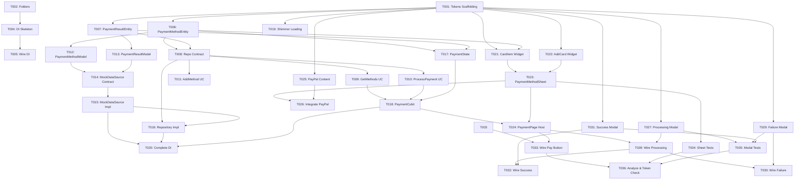

# Tasks: Payment Feature (Screens 51, 52, 53, 54, 55, 56)

**Input**: Design documents and specifications from `/specs/010-payment/`  
**Prerequisites**: [plan.md](./plan.md), [spec.md](./spec.md), [research.md](./research.md), [data-model.md](./data-model.md), [contracts/payment_contracts.md](./contracts/payment_contracts.md), [quickstart.md](./quickstart.md)  
**Branch**: `010-payment`  
**Organization**: Tasks are grouped into Setup, Foundational, User Stories (US1 → US2 → US3 → US4 → US5), Integration, and Polish phases to enable independent implementation and testing.

## Format: `- [ ] [TaskID] [P?] [Story?] Description with file path`

- **[P]**: Parallelizable (independent files, no blocking dependencies on incomplete tasks)
- **[Story]**: Belongs to a specific user story ([US1], [US2], [US3], [US4], [US5])
- Every task includes Prerequisites, Estimated Effort, and Quality Gate.

---

## Phase 1: Setup (Tokens Scaffolding, Directory Structure & DI Skeleton)

**Purpose**: Scaffolding directories, adding the 5 missing design tokens to `app_colors.dart`, route registration, and DI skeleton for `lib/features/payment/`.

- [x] T001 Add 5 payment design tokens to lib/core/theme/app_colors.dart
  - **Prerequisites**: None
  - **Estimated Effort**: 3m
  - **Quality Gate**: Rule #11 enforcement: add `blushSoft = Color(0xFFFFECEB)`, `visaBlue = Color(0xFF1A1F71)`, `mastercardRed = Color(0xFFEB001B)`, `mastercardYellow = Color(0xFFF79E1B)`, and `paypalBlue = Color(0xFF0079C1)` to `AppColors` before ANY UI work.

- [x] T002 Create folder structure in lib/features/payment/
  - **Prerequisites**: None
  - **Estimated Effort**: 2m
  - **Quality Gate**: Directories created: `domain/entities/`, `domain/repositories/`, `domain/usecases/`, `data/models/`, `data/datasources/`, `data/repositories/`, `presentation/manager/`, `presentation/pages/`, `presentation/widgets/`.

- [x] T003 [P] Add payment route constant in lib/config/routes/app_router.dart
  - **Prerequisites**: None
  - **Estimated Effort**: 2m
  - **Quality Gate**: Define `static const String payment = '/payment';` in `AppRoutes`.

- [x] T004 [P] Create DI registration skeleton in lib/features/payment/payment_injection.dart
  - **Prerequisites**: T002
  - **Estimated Effort**: 3m
  - **Quality Gate**: Define `void initPaymentInjection()` skeleton with `GetIt.instance`.

- [x] T005 Wire initPaymentInjection in lib/core/di/injection_container.dart
  - **Prerequisites**: T004
  - **Estimated Effort**: 2m
  - **Quality Gate**: `initPaymentInjection()` invoked inside `init()` in `injection_container.dart`.

---

## Phase 2: Foundational (Domain Entities, Repository Contract, Use Cases & Data Layer)

**Purpose**: Domain entities, repository contract, use cases, data models, mock data source with simulated gateway latency, repository implementation with `safeCall`, Cubit & State, and shimmer loading. MUST be completed before UI work.

- [x] T006 [P] Implement PaymentMethodEntity in lib/features/payment/domain/entities/payment_method_entity.dart
  - **Prerequisites**: T002
  - **Estimated Effort**: 5m
  - **Quality Gate**: Extends `Equatable`, contains `id`, `type` (`PaymentMethodType`), `cardBrand` (`CardBrand`), `maskedCardNumber`, `cardholderName`, `expiryDate`, `isDefault`.

- [x] T007 [P] Implement PaymentResultEntity in lib/features/payment/domain/entities/payment_result_entity.dart
  - **Prerequisites**: T002
  - **Estimated Effort**: 5m
  - **Quality Gate**: Extends `Equatable`, contains `id`, `orderId`, `status` (`PaymentStatus`), `message`, `amount`, `timestamp`.

- [x] T008 Define PaymentRepository contract in lib/features/payment/domain/repositories/payment_repository.dart
  - **Prerequisites**: T006, T007
  - **Estimated Effort**: 4m
  - **Quality Gate**: Abstract class defining `getPaymentMethods()`, `processPayment(method, amount)`, `addPaymentMethod(method)` returning `Either<Failure, T>` using `dartz`.

- [x] T009 [P] Implement GetPaymentMethodsUseCase in lib/features/payment/domain/usecases/get_payment_methods_usecase.dart
  - **Prerequisites**: T008
  - **Estimated Effort**: 4m
  - **Quality Gate**: Implements `UseCase<List<PaymentMethodEntity>, NoParams>` delegating to `PaymentRepository.getPaymentMethods()`.

- [x] T010 [P] Implement ProcessPaymentUseCase in lib/features/payment/domain/usecases/process_payment_usecase.dart
  - **Prerequisites**: T008
  - **Estimated Effort**: 5m
  - **Quality Gate**: Implements `UseCase<PaymentResultEntity, ProcessPaymentParams>` delegating to `PaymentRepository.processPayment()`.

- [x] T011 [P] Implement AddPaymentMethodUseCase in lib/features/payment/domain/usecases/add_payment_method_usecase.dart
  - **Prerequisites**: T008
  - **Estimated Effort**: 4m
  - **Quality Gate**: Implements `UseCase<void, PaymentMethodEntity>` delegating to `PaymentRepository.addPaymentMethod()`.

- [x] T012 [P] Implement PaymentMethodModel in lib/features/payment/data/models/payment_method_model.dart
  - **Prerequisites**: T006
  - **Estimated Effort**: 5m
  - **Quality Gate**: Extends `PaymentMethodEntity`, implements `fromJson`, `toJson`, `fromEntity`, `toEntity`.

- [x] T013 [P] Implement PaymentResultModel in lib/features/payment/data/models/payment_result_model.dart
  - **Prerequisites**: T007
  - **Estimated Effort**: 5m
  - **Quality Gate**: Extends `PaymentResultEntity`, implements `fromJson`, `toJson`, `fromEntity`, `toEntity`.

- [x] T014 [P] Define PaymentMockDataSource contract in lib/features/payment/data/datasources/payment_mock_data_source.dart
  - **Prerequisites**: T012, T013
  - **Estimated Effort**: 4m
  - **Quality Gate**: Abstract class declaring `getPaymentMethods()`, `processPayment()`, `addPaymentMethod()`.

- [x] T015 Implement PaymentMockDataSourceImpl in lib/features/payment/data/datasources/payment_mock_data_source_impl.dart
  - **Prerequisites**: T014
  - **Estimated Effort**: 8m
  - **Quality Gate**: In-memory mock data with 2 cards (Mastercard ending in 1579, Visa ending in 1579) and PayPal option; simulates 2–3s latency with `Future.delayed` and configurable/alternating success or failure result.

- [x] T016 Implement PaymentRepositoryImpl in lib/features/payment/data/repositories/payment_repository_impl.dart
  - **Prerequisites**: T008, T015
  - **Estimated Effort**: 5m
  - **Quality Gate**: Implements `PaymentRepository`, wraps datasource calls in core `safeCall` returning `Either<Failure, T>`.

- [x] T017 Define PaymentState in lib/features/payment/presentation/manager/payment_state.dart
  - **Prerequisites**: T006, T007
  - **Estimated Effort**: 5m
  - **Quality Gate**: Abstract class extending `Equatable` with states: `PaymentInitial`, `PaymentLoadingMethods`, `PaymentMethodSelection`, `PaymentProcessing`, `PaymentFailureState`, `PaymentSuccessState`, `PaymentError`.

- [x] T018 Implement PaymentCubit in lib/features/payment/presentation/manager/payment_cubit.dart
  - **Prerequisites**: T009, T010, T017
  - **Estimated Effort**: 8m
  - **Quality Gate**: Extends `Cubit<PaymentState>`, handles `loadPaymentMethods()`, `selectPaymentMethod()`, `processPayment()`, `retryPayment()`, `changePaymentMethod()`, `reset()`.

- [x] T019 Implement PaymentShimmerLoading in lib/features/payment/presentation/widgets/payment_shimmer_loading.dart
  - **Prerequisites**: T001
  - **Estimated Effort**: 4m
  - **Quality Gate**: Shimmer card placeholders using `shimmer` package and `AppSpacing` tokens.

- [x] T020 Complete DI bindings in lib/features/payment/payment_injection.dart
  - **Prerequisites**: T015, T016, T018
  - **Estimated Effort**: 3m
  - **Quality Gate**: Registers `PaymentCubit`, use cases, `PaymentRepository`, and `PaymentMockDataSource` with `GetIt sl`.

---

## Phase 3: User Story 1 (P1) — Payment Method Selection Sheet (Screens 51 & 52) 🎯 MVP

**Goal**: Deliver the primary payment method bottom sheet displaying saved credit cards (Mastercard, Visa) in a horizontal scrolling list, card settings button, and Add Card vertical button.

**Independent Test**: Navigate to `/payment`. Verify modal bottom sheet opens with rounded top corners (`24.r`), header "Payment Methods", and circular `✕` close button. Verify horizontal scrolling list displays Mastercard (light blue `AppColors.primarySoft`) and Visa (soft blush `AppColors.blushSoft`) with logos, masked number `* * * *   * * * *   * * * *   1579`, cardholder name "AMANDA", and expiry "12/22". Verify vertical Add Card button (`AppColors.primary`) with white `+` icon. Tapping a card closes sheet and triggers payment processing.

- [x] T021 [P] [US1] Implement PaymentCardItem in lib/features/payment/presentation/widgets/payment_card_item.dart
  - **Prerequisites**: T001, T006
  - **Estimated Effort**: 8m
  - **Quality Gate**: Renders card item (`16.r` rounded corners): Mastercard on `AppColors.primarySoft`, Visa on `AppColors.blushSoft`. Brand logos (Mastercard red/orange circles using `AppColors.mastercardRed` & `AppColors.mastercardYellow`, Visa logo using `AppColors.visaBlue`), white circular gear settings button, masked number, cardholder name, expiry. Strictly uses `AppColors`, `AppSpacing`, `AppTypography`.

- [x] T022 [P] [US1] Implement AddCardButton in lib/features/payment/presentation/widgets/add_card_button.dart
  - **Prerequisites**: T001
  - **Estimated Effort**: 4m
  - **Quality Gate**: Vertical rectangular container styled with `AppColors.primary`, rounded corners (`16.r`), and centered white `+` icon. Tapping shows informational placeholder.

- [x] T023 [US1] Implement PaymentMethodSheet in lib/features/payment/presentation/widgets/payment_method_sheet.dart
  - **Prerequisites**: T021, T022
  - **Estimated Effort**: 8m
  - **Quality Gate**: Modal bottom sheet (`24.r` top radius) with header "Payment Methods", circular `✕` close button, horizontally scrolling list of `PaymentCardItem`s and `AddCardButton`. Tapping a card invokes `onCardSelected` callback and dismisses sheet.

- [x] T024 [US1] Implement PaymentPage host in lib/features/payment/presentation/pages/payment_page.dart
  - **Prerequisites**: T018, T023
  - **Estimated Effort**: 8m
  - **Quality Gate**: Provides `BlocProvider<PaymentCubit>`, auto-opens `PaymentMethodSheet` via `showModalBottomSheet`, and coordinates state changes. Wire route in `app_router.dart` to `PaymentPage`.

---

## Phase 4: User Story 2 (P2) — PayPal Redirect Content (Screen 53)

**Goal**: Deliver the PayPal redirect option inside the payment method bottom sheet, showing PayPal branding, descriptive redirect text, and blue "OK" button.

**Independent Test**: Open `PaymentMethodSheet` with PayPal option active. Verify circular blue PayPal logo with white "P", centered text "You will be directed to PayPal", and blue pill "OK" button (`AppColors.primary`). Tapping "OK" dismisses sheet and initiates payment processing.

- [x] T025 [P] [US2] Implement PayPalRedirectContent in lib/features/payment/presentation/widgets/paypal_redirect_content.dart
  - **Prerequisites**: T001
  - **Estimated Effort**: 5m
  - **Quality Gate**: Centered layout with circular blue PayPal icon (`AppColors.paypalBlue`), subtitle "You will be directed to PayPal" in `AppTypography.bodySmall`, and full-width blue pill "OK" button reusing `PrimaryButton` or standard button styling with `AppColors.primary`.

- [x] T026 [US2] Integrate PayPal redirect view into PaymentMethodSheet in lib/features/payment/presentation/widgets/payment_method_sheet.dart
  - **Prerequisites**: T023, T025
  - **Estimated Effort**: 4m
  - **Quality Gate**: Supports rendering `PayPalRedirectContent` when PayPal is selected; tapping "OK" triggers `onPayPalSelected` and closes sheet to start processing.

---

## Phase 5: User Story 3 (P3) — Payment Processing Modal (Screen 54)

**Goal**: Deliver the non-dismissible payment processing modal with circular progress spinner, title, and subtitle simulating gateway execution.

**Independent Test**: Select a card or tap "OK" on PayPal. Verify centered modal dialog appears over dimmed/blurred background with white rounded container (`24.r`), circular grey badge with blue circular progress indicator, title "Payment in Progress", and subtitle "Please, wait a few moments". Modal is non-dismissible (`barrierDismissible: false`). After 2–3s, transitions to failure or success modal.

- [x] T027 [P] [US3] Implement PaymentProcessingModal in lib/features/payment/presentation/widgets/payment_processing_modal.dart
  - **Prerequisites**: T001
  - **Estimated Effort**: 6m
  - **Quality Gate**: Centered dialog (`24.r` rounded corners, white background), circular grey badge (`AppColors.surfaceAddress`) with blue circular progress indicator (`AppColors.primary`), bold title "Payment in Progress" in `AppTypography.h2`, and subtitle "Please, wait a few moments" in `AppTypography.bodySmall`. Wrapped in `PopScope(canPop: false)`.

- [x] T028 [US3] Wire processing modal lifecycle in lib/features/payment/presentation/pages/payment_page.dart
  - **Prerequisites**: T024, T027
  - **Estimated Effort**: 5m
  - **Quality Gate**: When `PaymentCubit` emits `PaymentProcessing`, display `PaymentProcessingModal` via `showDialog` with `barrierDismissible: false`. Automatically pop dialog when transitioning to `PaymentFailureState` or `PaymentSuccessState`.

---

## Phase 6: User Story 4 (P4) — Payment Failure Modal (Screen 55)

**Goal**: Deliver the payment failure modal with exclamation badge, failure reason, and side-by-side "Try Again" and "Change" buttons.

**Independent Test**: Trigger payment failure from Screen 54. Verify centered modal dialog displays grey circular badge with exclamation icon (`!`), title "We couldn't proceed your payment", subtitle "Please, change your payment method or try again", black pill "Try Again" button, and grey pill "Change" button. Tapping "Try Again" restarts processing; tapping "Change" closes dialog and re-opens `PaymentMethodSheet`.

- [x] T029 [P] [US4] Implement PaymentFailureModal in lib/features/payment/presentation/widgets/payment_failure_modal.dart
  - **Prerequisites**: T001
  - **Estimated Effort**: 6m
  - **Quality Gate**: Centered dialog (`24.r` radius, white background), grey circular badge (`AppColors.surfaceAddress`) with exclamation icon (`!`) in `AppColors.textSecondary`, title "We couldn't proceed your payment" in `AppTypography.h2`, subtitle "Please, change your payment method or try again" in `AppTypography.bodySmall`, and two side-by-side pill buttons: black "Try Again" (`AppColors.black`) and grey "Change" (`AppColors.surfaceOption`).

- [x] T030 [US4] Wire failure modal actions and recovery in lib/features/payment/presentation/pages/payment_page.dart
  - **Prerequisites**: T028, T029
  - **Estimated Effort**: 5m
  - **Quality Gate**: When state is `PaymentFailureState`, show `PaymentFailureModal`. Tapping "Try Again" invokes `paymentCubit.retryPayment()`; tapping "Change" invokes `paymentCubit.changePaymentMethod()` and re-opens `PaymentMethodSheet`.

---

## Phase 7: User Story 5 (P5) — Payment Success Modal (Screen 56)

**Goal**: Deliver the payment success confirmation modal with blue checkmark badge, confirmation text, and "Track your Order" button.

**Independent Test**: Trigger payment success from Screen 54. Verify centered modal dialog displays grey circular badge with solid blue circle and white checkmark (`✓`), bold title "Done!", subtitle "Your card has been successfully charged", and grey pill button "Track your Order". Tapping "Track your Order" closes dialog and navigates toward `/orders/:id` (or provides informative feedback), clearing modal stack.

- [x] T031 [P] [US5] Implement PaymentSuccessModal in lib/features/payment/presentation/widgets/payment_success_modal.dart
  - **Prerequisites**: T001
  - **Estimated Effort**: 6m
  - **Quality Gate**: Centered dialog (`24.r` radius, white background), grey circular badge with inner solid blue circle (`AppColors.primary`) and white checkmark icon (`✓`), title "Done!" in `AppTypography.h2`, subtitle "Your card has been successfully charged" in `AppTypography.bodySmall`, and full-width grey pill button "Track your Order" (`AppColors.surfaceOption` background, `AppColors.textPrimary` text).

- [x] T032 [US5] Wire success modal navigation in lib/features/payment/presentation/pages/payment_page.dart
  - **Prerequisites**: T028, T031
  - **Estimated Effort**: 5m
  - **Quality Gate**: When state is `PaymentSuccessState`, show `PaymentSuccessModal`. Tapping "Track your Order" navigates toward `/orders/:id` (or shows informational SnackBar fallback) and pops/replaces modal stack to prevent back-navigation to payment.

---

## Phase 8: Integration — Checkout to Payment Handoff

**Purpose**: Connect the checkout feature to the payment feature by wiring the "Pay" button.

- [x] T033 Connect Checkout "Pay" button to Payment route in lib/features/checkout/presentation/widgets/checkout_bottom_bar.dart
  - **Prerequisites**: T003, T024
  - **Estimated Effort**: 4m
  - **Quality Gate**: Tapping "Pay" button on `CheckoutBottomBar` triggers `context.push(AppRoutes.payment)` with current checkout total amount passed as an extra parameter.

---

## Phase 9: Polish & Verification

**Purpose**: End-to-end verification, token compliance checks, widget tests, and pixel-perfect comparison against Figma screenshots. Run ONLY ONCE at the end per Permanent Rule 1.

- [x] T034 [P] Implement widget tests for PaymentMethodSheet in test/features/payment/presentation/payment_sheet_test.dart
  - **Prerequisites**: T023
  - **Estimated Effort**: 8m
  - **Quality Gate**: Tests sheet rendering with Mastercard & Visa cards, Add Card button, tapping card invokes selection callback.

- [x] T035 [P] Implement widget tests for Payment Modals in test/features/payment/presentation/payment_modals_test.dart
  - **Prerequisites**: T027, T029, T031
  - **Estimated Effort**: 8m
  - **Quality Gate**: Tests `PaymentProcessingModal`, `PaymentFailureModal` with Try Again/Change callbacks, and `PaymentSuccessModal` with Track Order callback.

- [x] T036 Static analysis & token compliance verification
  - **Prerequisites**: T001-T035
  - **Estimated Effort**: 5m
  - **Quality Gate**: Run `fvm flutter analyze` per Permanent Rule 12. Must pass with 0 errors. Verify 100% token usage (zero hardcoded `Color(...)` or `Colors.` in `lib/features/payment/`).

---

## Dependencies & Execution Graph

