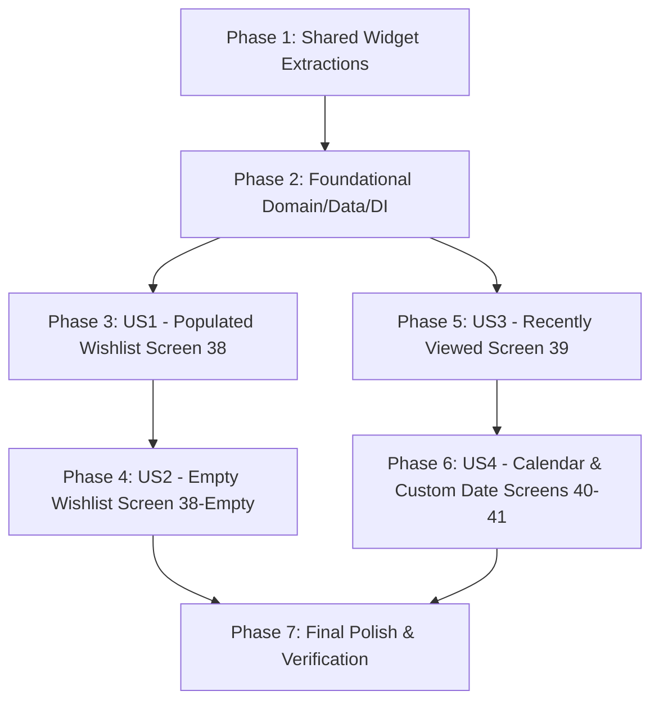

# Tasks: Wishlist & Recently Viewed (Screens 38–41)

**Input**: Design documents from `specs/011-wishlist/` (`spec.md`, `plan.md`, `data-model.md`, `contracts/wishlist_contracts.md`, `research.md`, `quickstart.md`)  
**Prerequisites**: All permanent project rules in `.specify/instructions/permanent-project-rules.md` and Constitution v1.2.0  
**Verification Timing**: No `fvm flutter analyze` or `fvm flutter test` until Phase 7 (final phase)  

---

## Phase 1: Shared Widget Extractions (DRY Foundation)

**Purpose**: Extract reusable presentation primitives so that Cart and Wishlist share the exact same row structure and chips without code duplication.

- [X] T001 [P] Extract reusable `MetaPill` widget in `lib/shared/widgets/meta_pill.dart` using `AppColors.primarySoft`, `AppColors.primary`, and `AppTypography`.
- [X] T002 [P] Extract reusable `ProductItemRow` widget in `lib/shared/widgets/product_item_row.dart` (90.w rounded image, bottom-left red delete icon, 2-line title, meta pills row, price, and customizable `trailingAction`).
- [X] T003 Refactor `lib/features/cart/presentation/widgets/cart_item_card.dart` to delegate its layout to `ProductItemRow` with `QuantityControl` as `trailingAction`.

**Checkpoint**: Shared primitives ready — Cart refactored cleanly before feature development begins.

---

## Phase 2: Foundational (Domain, Data, DI & Routing)

**Purpose**: Core Clean Architecture contracts, entities, use cases, mock data sources, and DI infrastructure.

- [X] T004 [P] Create `WishlistItemEntity` and `RecentlyViewedItemEntity` in `lib/features/wishlist/domain/entities/wishlist_item_entity.dart` and `lib/features/wishlist/domain/entities/recently_viewed_item_entity.dart`.
- [X] T005 [P] Create `DateTabEntity` in `lib/features/wishlist/domain/entities/date_tab_entity.dart`.
- [X] T006 Define `WishlistRepository` contract in `lib/features/wishlist/domain/repositories/wishlist_repository.dart`.
- [X] T007 [P] Implement `GetWishlistUseCase`, `RemoveFromWishlistUseCase`, and `AddToCartFromWishlistUseCase` in `lib/features/wishlist/domain/usecases/`.
- [X] T008 [P] Implement `GetRecentlyViewedUseCase` and `GetWishlistPopularProductsUseCase` in `lib/features/wishlist/domain/usecases/`.
- [X] T009 [P] Implement `WishlistItemModel`, `RecentlyViewedItemModel`, and `DateTabModel` in `lib/features/wishlist/data/models/`.
- [X] T010 Implement `WishlistMockDataSource` and `WishlistMockDataSourceImpl` in `lib/features/wishlist/data/datasources/wishlist_mock_datasource.dart` and `lib/features/wishlist/data/datasources/wishlist_mock_datasource_impl.dart` (5 wishlist items, 8 recently viewed items).
- [X] T011 Implement `WishlistRepositoryImpl` in `lib/features/wishlist/data/repositories/wishlist_repository_impl.dart` with `safeCall`.
- [X] T012 Create `lib/features/wishlist/wishlist_injection.dart` and register in `lib/core/di/injection_container.dart`.
- [X] T013 Register `/wishlist/recently-viewed` route in `lib/config/routing/route_names.dart` and `lib/config/routing/app_router.dart`.

**Checkpoint**: Foundation complete — data flows and DI bindings ready for presentation layer.

---

## Phase 3: User Story 1 (P1) — Populated Wishlist (Screen 38) 🎯 MVP

**Goal**: Display vertical list of saved items with delete and add-to-cart actions.  
**Independent Test**: Open Wishlist tab; verify item image, title, price, meta pills (`Pink`, `M`), trash button removal, and add-to-cart action.

- [X] T014 [US1] Implement `WishlistCubit` and `WishlistState` in `lib/features/wishlist/presentation/cubit/wishlist_cubit.dart` and `lib/features/wishlist/presentation/cubit/wishlist_state.dart`.
- [X] T015 [P] [US1] Implement `WishlistHeader` in `lib/features/wishlist/presentation/widgets/wishlist_header.dart` (title "Wishlist" + circular `✕` dismiss button).
- [X] T016 [P] [US1] Implement `WishlistItemRow` in `lib/features/wishlist/presentation/widgets/wishlist_item_row.dart` wrapping `ProductItemRow` with blue cart icon button.
- [X] T017 [P] [US1] Implement `WishlistShimmerLoading` in `lib/features/wishlist/presentation/widgets/wishlist_shimmer_loading.dart`.
- [X] T018 [US1] Implement populated list view in `lib/features/wishlist/presentation/pages/wishlist_page.dart` with `WishlistCubit` integration, deletion, and add-to-cart actions.

**Checkpoint**: User Story 1 functional — users can view, remove, and add wishlist items to cart.

---

## Phase 4: User Story 2 (P2) — Empty Wishlist + Most Popular (Screen 38-Empty)

**Goal**: Seamless transition to empty state with recommendations when wishlist is empty.  
**Independent Test**: Remove all wishlist items; verify circular heart badge, "Your Wishlist is Empty" text, and "Most Popular" horizontal carousel with working "See All →" and card taps.

- [X] T019 [US2] Implement `WishlistEmptyView` in `lib/features/wishlist/presentation/widgets/wishlist_empty_view.dart` reusing circular badge pattern and `MostPopularSection` + `PopularProductCard` from `feature/home`.
- [X] T020 [US2] Integrate `WishlistEmptyView` into `lib/features/wishlist/presentation/pages/wishlist_page.dart` when items list is empty or last item is removed.

**Checkpoint**: User Story 2 functional — empty state prevents dead-ends and guides users to popular products.

---

## Phase 5: User Story 3 (P3) — Recently Viewed with Date Tabs (Screen 39)

**Goal**: Display 2-column grid of recently viewed products with "Today" and "Yesterday" filter tabs.  
**Independent Test**: Navigate to `/wishlist/recently-viewed`; verify "Today" (selected with checkmark) and "Yesterday" tabs filter the 2-column `ShopProductCard` grid.

- [X] T021 [US3] Implement `RecentlyViewedCubit` and `RecentlyViewedState` in `lib/features/wishlist/presentation/cubit/recently_viewed_cubit.dart` and `lib/features/wishlist/presentation/cubit/recently_viewed_state.dart` with Today/Yesterday tab filtering.
- [X] T022 [P] [US3] Implement `RecentlyViewedHeader` in `lib/features/wishlist/presentation/widgets/recently_viewed_header.dart` (title "Recently viewed" + circular `✕` button).
- [X] T023 [P] [US3] Implement `RecentlyViewedDateTabs` in `lib/features/wishlist/presentation/widgets/recently_viewed_date_tabs.dart` (Today/Yesterday tabs, active checkmark, and circular blue `∨` chevron button).
- [X] T024 [P] [US3] Implement `RecentlyViewedShimmerLoading` in `lib/features/wishlist/presentation/widgets/recently_viewed_shimmer_loading.dart` for the 2-column grid.
- [X] T025 [US3] Create `lib/features/wishlist/presentation/pages/recently_viewed_page.dart` with 2-column `ShopProductCard` grid filtered by selected tab.

**Checkpoint**: User Story 3 functional — browsing history accessible by Today/Yesterday tabs.

---

## Phase 6: User Story 4 (P4) — Calendar & Custom Date Filtering (Screens 40, 41)

**Goal**: Expandable inline calendar date picker allowing selection of past dates and dynamic tab creation.  
**Independent Test**: Tap chevron `∨`; verify calendar expands (Screen 40); pick day 18; verify calendar collapses and new active tab "April, 18" appears with its filtered products (Screen 41).

- [X] T026 [US4] Implement `RecentlyViewedCalendar` in `lib/features/wishlist/presentation/widgets/recently_viewed_calendar.dart` with month navigation (`< April >`), 7-column day grid (01–31), day selection highlight, and bottom collapse button `^`.
- [X] T027 [US4] Extend `RecentlyViewedCubit` to handle `toggleCalendar()`, `changeMonth()`, and `selectDate()` to dynamically add and activate custom date tabs (e.g., "April, 18").
- [X] T028 [US4] Connect `RecentlyViewedCalendar` and dynamic tabs into `lib/features/wishlist/presentation/pages/recently_viewed_page.dart` for seamless inline expand/collapse.

**Checkpoint**: User Story 4 functional — full date exploration via inline calendar complete.

---

## Phase 7: Polish, Verification & Quality Assurance (Run Once at End)

**Purpose**: Format code, run static analysis, and verify all unit/widget tests passing 100% green.

- [X] T029 [P] Create widget tests in `test/features/wishlist/presentation/wishlist_page_test.dart` and `test/features/wishlist/presentation/recently_viewed_page_test.dart`.
- [X] T030 Run `dart format lib test` to ensure 100% clean formatting.
- [X] T031 Run `fvm flutter analyze` to verify 0 issues across the entire codebase.
- [X] T032 Run `fvm flutter test` to verify all tests pass (100% green).

---

## Phase 8: Convergence (UI & DRY Remediations)

**Purpose**: Fix visual deviations and DRY violations identified during manual verification of Screens 38–41.

- [X] T033 [CRITICAL] Unify `ProductItemRow` layout with `MetaPill` chips across Cart and Wishlist per Fix 1 (`lib/shared/widgets/product_item_row.dart`, `lib/features/cart/presentation/widgets/cart_item_card.dart`, `lib/features/wishlist/presentation/widgets/wishlist_item_row.dart`).
- [X] T034 [HIGH] Ensure `MostPopularSection` in Empty Wishlist renders tags/badges and reuses existing widget per Fix 2 (`lib/features/wishlist/data/datasources/wishlist_mock_datasource_impl.dart`).
- [X] T035 [HIGH] Restructure `WishlistEmptyView` layout so empty state is centered and Most Popular is anchored at the bottom per Fix 3 (`lib/features/wishlist/presentation/widgets/wishlist_empty_view.dart`).
- [X] T036 [HIGH] Update `RecentlyViewedDateTabs` to content-based width aligned left with spacer before chevron button per Fix 4 (`lib/features/wishlist/presentation/widgets/recently_viewed_date_tabs.dart`).
- [X] T037 [HIGH] Update `RecentlyViewedCubit` date tab management so custom date replaces "Yesterday" per Fix 5 (`lib/features/wishlist/presentation/cubit/recently_viewed_cubit.dart`).
- [X] T038 [HIGH] Refine `RecentlyViewedCalendar` visual styling to match Figma 40 pixel-perfect per Fix 6 (`lib/features/wishlist/presentation/widgets/recently_viewed_calendar.dart`).

---

## Dependencies & Execution Order

---

## Parallel Execution Opportunities

- **Phase 1**: T001 (`MetaPill`) and T002 (`ProductItemRow`) can be written in parallel.
- **Phase 2**: T004, T005 (Entities), T007, T008 (UseCases), and T009 (Models) can all run in parallel.
- **Phase 3**: T015 (`WishlistHeader`), T016 (`WishlistItemRow`), and T017 (`WishlistShimmerLoading`) can run in parallel before T018.
- **Phase 5**: T022 (`RecentlyViewedHeader`), T023 (`RecentlyViewedDateTabs`), and T024 (`RecentlyViewedShimmerLoading`) can run in parallel before T025.
- **Phase 7**: T029 (Tests) can be authored in parallel with formatting.
